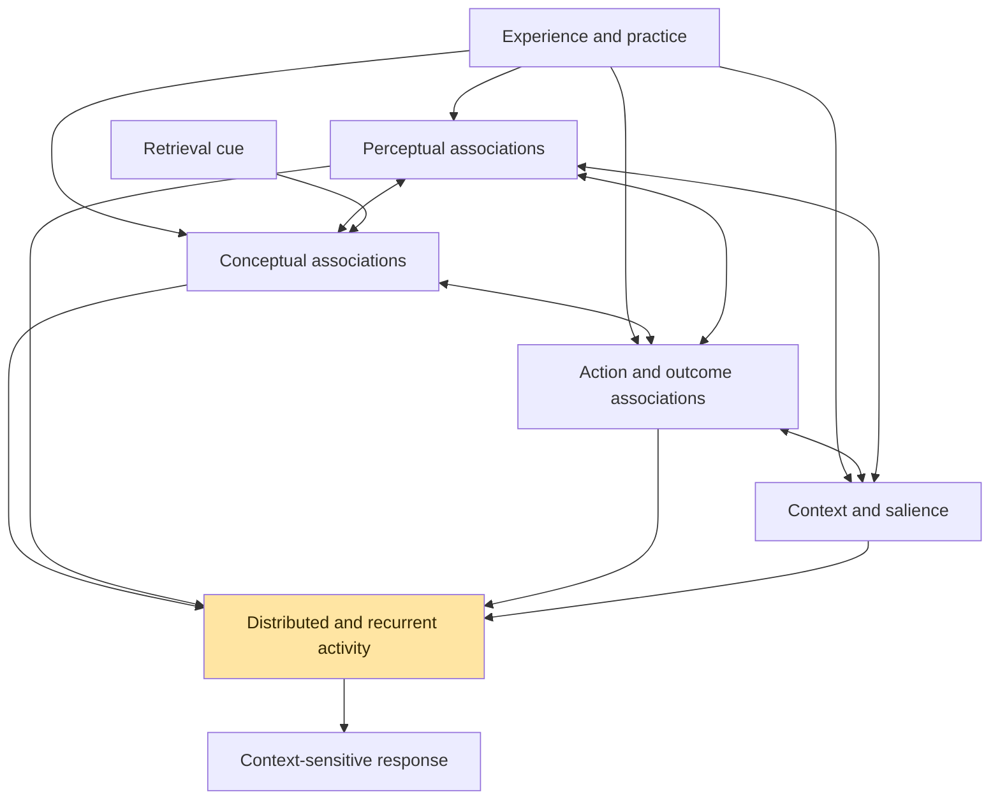
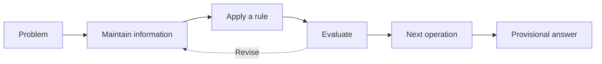
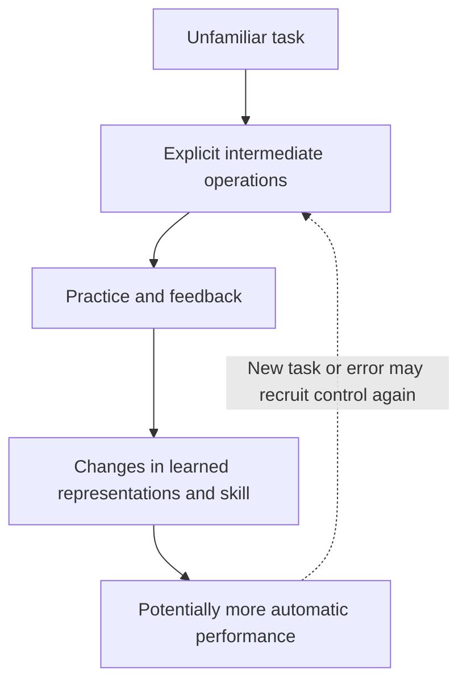
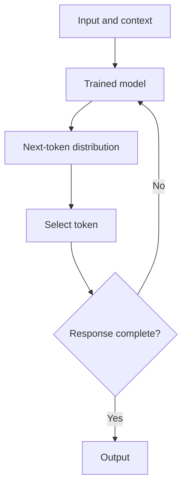
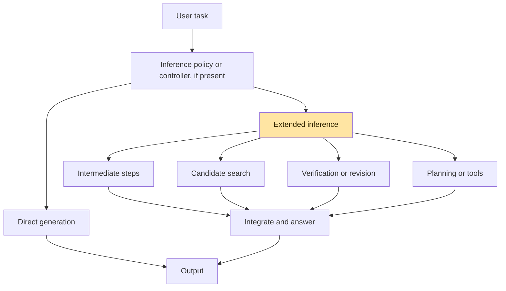
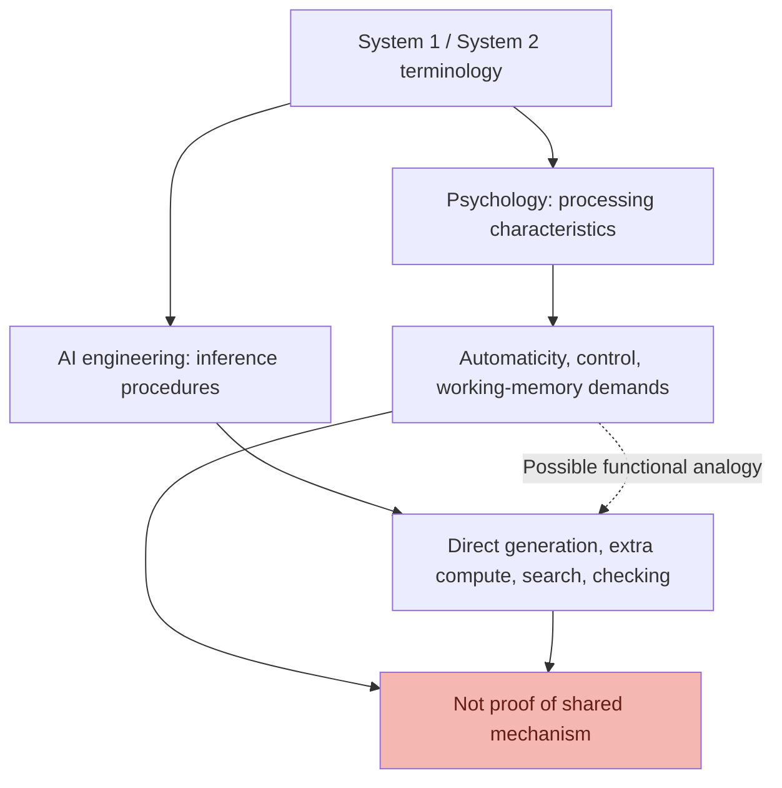
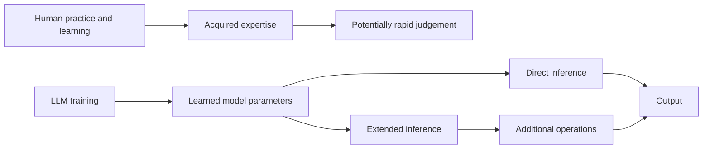
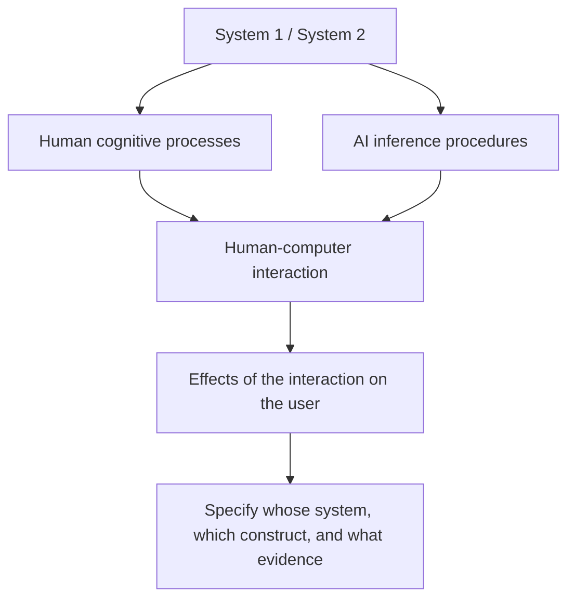
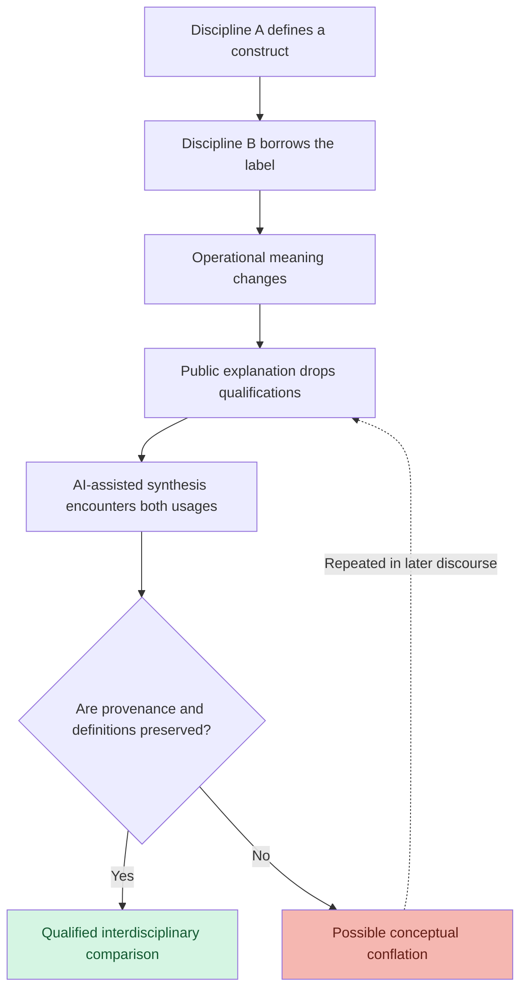
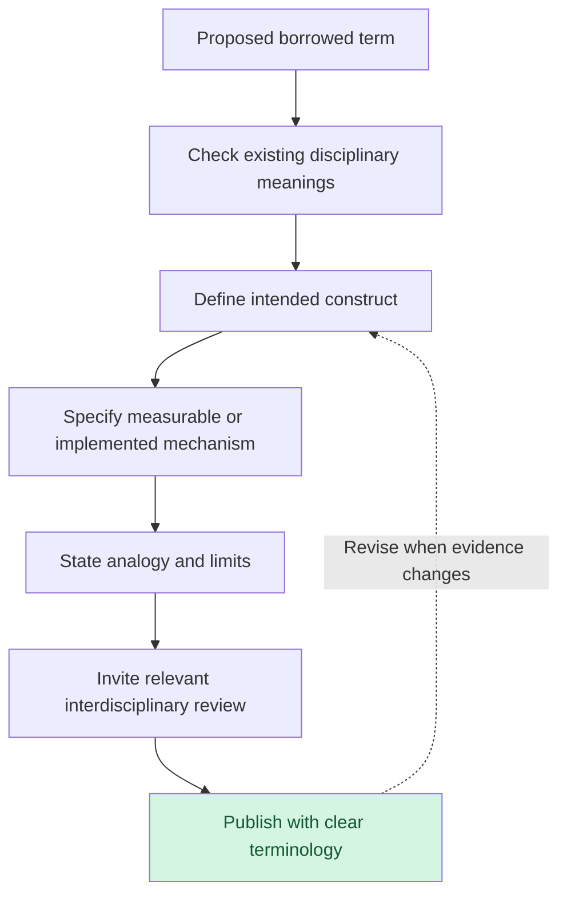

# 🧠 System 1, System 2 & Neuronal Webs
**First created:** 2026-10-18 | **Last updated:** 2026-10-18  
*On human learning, LLM inference, borrowed psychological terminology, and the revolutionary discovery that other university departments exist.*

---

## 🛰️ Orientation — Please Visit the Other Buildings

Some AI systems can spend additional computation on a problem: generating intermediate steps, comparing possible answers, searching, checking, revising, or using tools. This is interesting engineering. It is not, by itself, evidence that a machine possesses the human psychological processes associated with *Type 2 thinking*.

Yet the industry increasingly uses **System 1** and **System 2** to distinguish comparatively direct generation from extended inference. These labels were borrowed deliberately from dual-process psychology, where the terms already have complicated histories and contested meanings. The analogy is close enough to invite recognition, but often insufficiently specified to tell readers *which* similarities are intended.

That is the irritation from which this node begins. Not a blanket indictment of engineers: many researchers are careful, collaborative, and perfectly capable of reading a paper outside their home discipline. Nor is it a claim that psychology owns two integers. It is a complaint about **scientific terminology as shared infrastructure**, especially when promotional interviews turn a qualified analogy into pop psychology.

If LLMs are meant to help us connect scholarship across disciplines, making disciplinary vocabularies needlessly incompatible is a peculiar way to start.

> **ENGINEERING:** We have developed a revolutionary new model of thinking.  
> **PSYCHOLOGY:** Oh! Which theory are you building on?  
> **ENGINEERING:** System 1 and System 2.  
> **PSYCHOLOGY:** Wonderful! So you've incorporated automaticity, cognitive control, working-memory—  
> **ENGINEERING:** One does more tokens.  
> **PSYCHOLOGY:** …  
> **NEUROSCIENCE:** Sorry, what?  
> **HCI:** I specifically warned you about this.  
> **ENGINEERING:** We made a diagram.  
> **CYBERNETICS:** You've made a terminology problem.  
> **ENGINEERING:** It's a very good diagram.  
> **🦆 POLARIS:** LADS. THERE ARE OTHER BUILDINGS ON CAMPUS.

*The departmental conversations in this node are fictional satire, not quotations from researchers or evidence about any particular institution.*

---

## 1. 🧠 The Psychology Department Was Already Here

Dual-process accounts distinguish forms or characteristics of human processing, often contrasting relatively automatic operations with more controlled, working-memory-demanding ones. Their intellectual history long predates the popular success of Daniel Kahneman's *Thinking, Fast and Slow* (2011). Work associated with Jonathan Evans, Keith Stanovich and Richard West is essential here; their accounts are not identical, and some scholars prefer **Type 1 / Type 2** precisely to avoid implying two discrete, person-like systems inside the head.

A useful beginner's contrast is that Type 1 processing tends to be relatively autonomous and places comparatively modest demands on working memory; Type 2 is more associated with cognitive control, hypothetical thinking, and working-memory involvement. But neither type is a synonym for accuracy, intelligence, sophistication, rationality, or a particular set of anatomical structures.

| Tempting shortcut | What it misses |
|---|---|
| Type 1 = fast and stupid | Automatic expertise can be accurate and sophisticated. |
| Type 2 = slow and clever | Deliberation can rationalise errors or apply the wrong rule. |
| Type 1 = a simple neural pathway | Psychological categories do not specify a neuron count or wiring diagram. |
| Type 2 = a second brain | A processing distinction is not proof of two anatomical machines. |
| More conscious steps = more underlying complexity | Response-time organisation and accumulated learning are different variables. |

This node uses **Type 1/Type 2** when discussing psychological processing and **AI-labelled System 1/System 2** when discussing engineering shorthand. Even that convention is a practical clarification, not a claim that psychological terminology has one uncontested definition.

### What exactly is being classified?

Human researchers might study how a person reasons, the demands a task places on working memory, the conditions under which a judgement becomes automatic, or the interaction between automatic responses and deliberate control. Those are questions about cognition and behaviour. To identify the underlying neural implementation requires another level of evidence.

**A classification of processing characteristics is not a map of memory storage.** This is the first distinction the borrowed labels can obscure.

---

## 2. 🕸️ Neuronal Webs — Learning Is Not a Queue

Accumulated human learning is better introduced through **interacting, overlapping neural populations and changing connections** than through a cartoon of two independent queues, one fast and one slow. Memories and skills recruit distributed systems; their representations can overlap. Experience changes connections and patterns of activation. Cues can help reinstate learned information, sometimes through pattern completion; retrieval is sensitive to context, goals, and the history of learning.

None of this means that a memory is literally a tidy spiderweb, or that all memories operate identically. Episodic recollection, semantic knowledge, procedural skills, working memory, and emotional learning involve partly different systems and mechanisms. The point is that their interactions are much richer than a single straight line of conscious steps.

*Conceptual map of overlapping contributions to cognition; not an anatomical connectome, nor a universal model of memory retrieval.*

A clinician may recognise a worrying pattern quickly because of years of study, observation and feedback. A musician may anticipate the next phrase without consciously computing each relationship. A mechanic may hear a fault before being able to explain it. None of those responses is simple merely because it is rapid.

**Fast retrieval does not imply shallow learning.** The visible response can be brief precisely because the learning history is extensive.

This also gives us a fairer comparison with artificial neural networks. LLMs likewise use learned, distributed representations. The difference is not “brains have networks, machines have strings”. The differences concern training and adaptation, embodiment, memory organisation, neural dynamics, interaction with environments, and the nature of the task being performed. A serious comparison must specify which of these it is comparing.

---

## 3. 🧵 The Deliberative String — A Useful Picture, Not a Neuron Map

For teaching purposes, Type 2 processing can *look* more string-like: hold an intermediate result, apply a rule, check it, revise, continue. This captures the **serial organisation of consciously managed operations**, not a literal line of neurons firing one after another. Controlled reasoning still depends on distributed, parallel, recurrent neural activity.

The interesting contrast is therefore **a web of accumulated associations versus a string-like description of deliberate task steps**, not “many neurons versus few neurons”. We should never mistake a pedagogical diagram for a microscopic photograph.

Consider learning multiplication. At first, a learner may count, rehearse rules, maintain intermediate results, and check each operation. With practice, some answers become readily retrievable. The answer did not become less mathematically meaningful when it became easier to access.

Automaticity is not an irreversible promotion from one sealed box into another. Human control and learned responses interact; task difficulty, fatigue, uncertainty, motivation, and context can all matter.

**Learning history, neural activity, conscious sequencing, latency, and correctness are five different measurements.** They should not be collapsed into one number labelled “thinking”.

---

## 4. ⚙️ What the Engineering Labels Actually Do

In LLM discussions, **System 1** often refers to relatively direct generation: a trained model receives context and generates successive tokens. **System 2** often refers to some form of *additional inference-time computation*. Neither label denotes one universally standardised architecture.

Direct generation is not one mathematical step. Autoregressive models repeatedly compute token distributions, and each step involves extensive numerical operations. The distinction is that the system is not necessarily orchestrating a separate extended search, verification, or deliberation procedure before returning an answer.

The so-called System 2 family is heterogeneous:

| Engineering procedure | What the system actually does | Why precision matters |
|---|---|---|
| Intermediate-step generation | Produces additional tokens or representations before an answer | A generated explanation is not necessarily faithful or correct. |
| Multiple candidates | Samples several possible solutions | Diversity of attempts differs from sequential reasoning. |
| Search | Explores alternatives through a search procedure | Search strategy and scoring matter. |
| Verification | Checks an answer with a model, tool, or formal method | Independent checking differs from self-asserted correctness. |
| Iterative revision | Reconsiders or edits a candidate | Revision can improve or degrade performance. |
| Planning and tools | Coordinates external actions or computations | Not all work occurs inside the language model. |
| Adaptive compute | Allocates resources according to task or uncertainty | More compute is a policy choice, not a psychological diagnosis. |

*Illustrative menu, not a claim that every deployed LLM has an explicit controller or all four extended-inference branches.*

A model might use the **same learned parameters** in direct and extended inference. Another system might add specialist components, verifiers, tools, or separate models. Additional steps at inference do not necessarily update the model's parameters. Training, context use, external retrieval, and persistent learning must be distinguished.

> **ENGINEERING:** We've developed System 2 reasoning.  
> **PSYCHOLOGY:** Which mechanism?  
> **ENGINEERING:** Extended inference.  
> **PSYCHOLOGY:** Which kind?  
> **ENGINEERING:** Well, there are several.  
> **PSYCHOLOGY:** Excellent. Could we perhaps name them?  
> **🦆 POLARIS:** WE HAVE DISCOVERED THE PURPOSE OF NOUNS.

---

## 5. 🪞 The False Friend — Same Signs, Different Objects

The terminology is not completely random. Direct versus extended inference has an intelligible **functional resemblance** to automatic versus controlled responding. An AI system that checks intermediate work may behave, in some tasks, like a person deliberately reviewing an answer. That is a potentially useful comparison.

But the analogy is **not an identity claim**. Psychology classifies features of human processing; AI engineers often classify inference procedures or resource allocation. Neuroscience investigates biological implementation. HCI asks how people understand and use systems. One borrowed name is now doing several jobs.

| Question | Psychology | AI engineering |
|---|---|---|
| What is being studied? | Human cognition and behaviour | Computational procedures and performance |
| What does “fast” capture? | Often an observable processing characteristic | Often latency, tokens, or resource cost |
| What does “deliberation” mean? | Cognitive control and working-memory-dependent activity | Often extra generated steps, search, checking, or planning |
| What is learning? | Experience-dependent biological and cognitive change | Typically parameter optimisation, with other adaptation mechanisms possible |
| What is retrieval? | Cue- and context-sensitive access or reconstruction | Can mean use of parameters, context, or an external retrieval system |
| What counts as evidence? | Behavioural and cognitive experiments; neural evidence for implementation | Architectural description, compute accounting, evaluations, ablations |

### The apparent inversion

In human expertise, more accumulated learning can make a sophisticated judgement require **fewer conscious intermediate steps**. In many LLM reasoning systems, **more inference-time steps** are deliberately allocated to improve performance on difficult tasks.

This is not a literal reversal of total computation: automatic human processing may recruit enormous parallel neural activity, and LLM direct generation is computationally intensive. The apparent inversion appears because the two fields are counting different things.

**The number of visible intermediate operations is not a measure of the complexity of the knowledge being used.** This is the point to carry out of the section, even if the reader remembers nothing else.

---

## 6. 🖥️ HCI — The Department That Studies This Exact Sort of Confusion

Human–computer interaction has long studied mental models: the expectations people develop about how a system works, and how terminology and interface design shape those expectations. A familiar term can activate a reasonable but inaccurate conceptual model.

If someone familiar with psychological dual-process theory encounters “System 2” in an AI interview, they may expect a closer relationship to the psychological construct than the engineering procedure warrants. This is not automatically a failure of the listener. The terminology was chosen for its recognisable resemblance.

HCI researchers may simultaneously need to discuss **the human user's Type 2 processing**, **the AI's so-called System 2**, and **how interaction between them changes the human user's behaviour**. These are three different referents in one room.

> **HCI:** The label affects what users think the system is doing.  
> **ENGINEERING:** But our technical paper defines it.  
> **HCI:** Good. Does the interview?  
> **ENGINEERING:** …  
> **🦆 POLARIS:** THE INTERVIEW IS ALSO AN INTERFACE, LADS.

---

## 7. 🦆 The Researchers Are Not the Villains

This distinction is non-negotiable. The criticism is **not** that ordinary engineering researchers are arrogant, stupid, or unwilling to collaborate. There is already extensive interdisciplinary work spanning machine learning, psychology, cognitive science, neuroscience, linguistics, philosophy, and HCI. Many technical papers define their analogies carefully. Many people in those fields are doing exactly the work this node wants to see.

A promotional interview is not the same object as a research paper. A company's incentive to make its products sound remarkable is not evidence of an individual researcher's motivation. And not every use of “System 2” is a conceptual error: an explicitly qualified analogy can be useful.

The request is narrower and more practical: **when borrowing an established term, say what you borrowed, what you changed, and what you are *not* claiming.** Future researchers should not have to reverse-engineer a promotional metaphor before they can compare findings.

> **ENGINEERING RESEARCHER:** Our implementation uses iterative inference and a verifier. We claim a functional analogy, not neurological equivalence.  
> **PSYCHOLOGY:** Excellent.  
> **HCI:** Very helpful.  
> **NEUROSCIENCE:** We can work with that.  
> **INDUSTRY INTERVIEW:** So the AI now thinks exactly like a human?  
> **EVERY DEPARTMENT:** NO.  
> **🦆 POLARIS:** THIS IS WHY WE CAN'T HAVE NICE CONSTRUCTS.

---

## 8. 🧪 Chemistry Has Entered the Chat

Scientific nomenclature is not an eccentric dream invented by a cross-disciplinary reader who has finally had enough. The **International Union of Pure and Applied Chemistry (IUPAC)** coordinates internationally recognised chemical nomenclature and terminology. Its familiar colour-coded reference works include the **Blue Book** (organic nomenclature), **Red Book** (inorganic nomenclature), **Gold Book** (chemical terminology), and **Green Book** (quantities, units, and symbols in physical chemistry).

These conventions help researchers communicate across institutions and languages. They do not force chemists to agree on every theory; nor do they abolish synonyms, historical names, or ambiguity. They make distinctions *manageable*.

AI is not without standards either. **ISO/IEC 22989** addresses AI concepts and terminology; **ISO/IEC JTC 1/SC 42** undertakes AI standardisation. Broader terminology work includes **ISO 704** and **ISO 1087**. Their existence does not establish that every collision between psychology and AI engineering has already been resolved. It does establish that terminology coordination is a real, mature kind of scientific work.

The question for further documentary examination is not “why has nobody ever thought of standards?” It is: **do existing standards and publishing practices adequately identify borrowed cognitive terms, their operational meanings, and the boundaries of the analogy?**

> **CHEMISTRY:** We established international naming conventions because researchers need to understand one another.  
> **ENGINEERING:** We have developed System 2.  
> **PSYCHOLOGY:** We already use that term.  
> **ENGINEERING:** Ours is different.  
> **PSYCHOLOGY:** That's fine. Could you distinguish them?  
> **CHEMISTRY:** Would you like a nomenclature committee?  
> **🦆 POLARIS:** YES. GIVE THEM A FUCKING COMMITTEE.

---

## 9. 🤖 When the Literature Starts Talking to Itself

The stakes rise when LLMs are used to summarise literature, compare research programmes, suggest hypotheses, and translate concepts between fields. The same term may appear in papers that mean different things by it. A system can often disambiguate from context, but not always; unclear source terminology increases the burden on researchers and machines alike.

A possible failure pathway looks like this:

This is a **risk model**, not a claim that every model makes this error or that all ambiguity can be eliminated. It is a cybernetic problem because descriptions travel through publications, interviews, datasets, retrieval systems, generated explanations, and back into human understanding. Feedback can preserve distinctions or erase them.

The information-ecology point is that a term is not merely a string of characters. It carries disciplinary provenance, assumptions, measurement practices, and limits. Different readers can process the same sign into different information because they arrive with different conceptual histories.

**If AI is supposed to help connect human knowledge, conceptual interoperability is part of the infrastructure.**

---

## 10. 🛠️ A Small Protocol for Borrowed Scientific Terms

Nobody needs to ban metaphor. Nobody needs to insist that psychology, neuroscience, and computer science adopt identical ontologies. A modest protocol would already help:

| Check | What to state |
|---|---|
| **Definition** | What does this term mean in this paper or system? |
| **Provenance** | From which field or theory was it borrowed? |
| **Operationalisation** | Which process, measurement, or implementation does it denote? |
| **Analogy boundary** | Which similarities are claimed, and which are not? |
| **Interoperability** | How should a reader from another discipline distinguish the usages? |

Where precision matters, descriptive labels such as **direct generation**, **extended inference**, **candidate search**, **verification-augmented inference**, or **human Type 2 processing** often do more work than an unqualified “System 2”. These are suggestions for clarity, not an invented international standard.

This proposal also needs restraint: sometimes a shared term is productive, a specialist community already defines it adequately, or the intended audience understands the shorthand. The task is not to eradicate every ambiguity. It is to avoid ambiguity **where it obstructs scientific comparison**.

---

## 11. 🦆 Please Visit the Other Buildings

The mathematics can be interesting. The engineering can be useful. Psychological theory can inspire productive computational research. Cognitive science can learn from artificial systems, too. None of that requires pretending a shared label proves a shared mechanism.

The original annoyance survives the careful qualifications: **there is a difference between doing innovative work and communicating it as though the rest of the intellectual world began yesterday.** There are researchers downstream who need the vocabulary to remain interpretable. There are students trying to learn what the terms mean. There are LLMs being asked to stitch together literatures whose definitions were not written for one another.

And there is already a long history of scientific communities agreeing how to name things without agreeing on everything else.

> **ENGINEERING:** We would like AI to accelerate scientific discovery.  
> **PSYCHOLOGY:** Wonderful.  
> **NEUROSCIENCE:** We're interested.  
> **HCI:** We can help.  
> **CYBERNETICS:** We have some relevant frameworks.  
> **CHEMISTRY:** We brought nomenclature standards.  
> **ENGINEERING:** Oh.  
> **🦆 POLARIS:** SEE? FRIENDS.  
> **ENGINEERING:** This is actually quite useful.  
> **🦆 POLARIS:** YES. THAT IS GENERALLY WHAT HAPPENS WHEN YOU TALK TO PEOPLE.  
> **CHEMISTRY:** There are biscuits.  
> **🦆 POLARIS:** FUCKING FINALLY.

**The maths is allowed to be clever. The nomenclature is also required to make sense.**

---

## 📚 Sources and Further Reading

The sources below establish starting points for the relevant traditions. They should not be mistaken for a completed systematic review of contemporary AI marketing or every System 1/System 2 architecture. Particular public claims should be checked against their original paper or interview before being attributed to a person or company.

### Cognitive psychology and neuroscience

- [Kahneman: *Thinking, Fast and Slow* (2011)](https://us.macmillan.com/books/9780374533557/thinkingfastandslow) — influential popular synthesis; not the origin of all dual-process theory.
- [Evans: “Dual-Processing Accounts of Reasoning, Judgment, and Social Cognition” (2008)](https://doi.org/10.1146/annurev.psych.59.103006.093629) — survey of dual-process approaches.
- [Stanovich and West: “Individual Differences in Reasoning: Implications for the Rationality Debate?” (2000)](https://doi.org/10.1017/S0140525X00003435) — reasoning, rationality, and dual-process distinctions.
- [Squire: “Memory Systems of the Brain: A Brief History and Current Perspective” (2004)](https://doi.org/10.1016/j.nlm.2004.06.005) — different memory systems and their study.
- [McClelland, McNaughton and O'Reilly: “Why There Are Complementary Learning Systems in the Hippocampus and Neocortex” (1995)](https://doi.org/10.1037/0033-295X.102.3.419) — learning systems and complementary mechanisms.

### LLM engineering

- [Wei et al.: “Chain-of-Thought Prompting Elicits Reasoning in Large Language Models” (2022)](https://arxiv.org/abs/2201.11903) — intermediate reasoning-step prompting.
- [Wang et al.: “Self-Consistency Improves Chain of Thought Reasoning in Language Models” (2022/2023)](https://arxiv.org/abs/2203.11171) — sampling and aggregating reasoning paths.
- [Yao et al.: “Tree of Thoughts: Deliberate Problem Solving with Large Language Models” (2023)](https://arxiv.org/abs/2305.10601) — structured exploration of alternatives.
- [Yao et al.: “ReAct: Synergizing Reasoning and Acting in Language Models” (2022/2023)](https://arxiv.org/abs/2210.03629) — reasoning and tool/action interaction.

### Nomenclature and standards

- [IUPAC: Gold Book](https://goldbook.iupac.org/) — chemical terminology.
- [IUPAC: Nomenclature](https://iupac.org/what-we-do/nomenclature/) — international nomenclature work.
- [ISO/IEC 22989: Artificial intelligence concepts and terminology](https://www.iso.org/standard/74296.html) — AI terminology standard.
- [ISO/IEC JTC 1/SC 42: Artificial intelligence](https://www.iso.org/committee/6794475.html) — AI standardisation committee.

### Research still needed before treating this as an exhaustive literature review

- Compare specific recent papers using “System 1/System 2” in their titles or architecture descriptions, rather than treating the entire field as uniform.
- Examine specific public interviews and record exact wording before arguing that a claim was oversold.
- Review HCI literature on mental models and cross-disciplinary terminology in AI products.
- Check the detailed scopes and current editions of ISO 704, ISO 1087 and ISO/IEC 22989 for any existing provisions addressing borrowed constructs.
- Investigate contemporary cognitive-science criticisms of binary dual-process descriptions, including cases where the distinction does not map cleanly onto observed behaviour.

---

## 🌌 Constellations

🧠 🕸️ ⚙️ 🧪 🦆 — Human learning, distributed representation, inference procedures, conceptual interoperability, and the administration of interdisciplinary peace.

Related routes within Polaris:

- `🌑_1_Origin_Points/🪿_Embodied_Information_Ecology/` — embodiment, information and context.
- `🌑_1_Origin_Points/🪿_Embodied_Information_Ecology/♻️_Cybernetics/` — systems and feedback.
- `🌑_1_Origin_Points/🍔_Burger_Basics/📩_Large_Language_Misconcepts/` — AI terminology and misconception literacy.

## ✨ Stardust

dual-process theory, Type 1, Type 2, System 1, System 2, neuronal webs, distributed representation, associative retrieval, automaticity, working memory, expertise, chain-of-thought, inference-time compute, HCI, mental models, scientific nomenclature, IUPAC, ISO/IEC 22989, construct validity, conceptual interoperability, interdisciplinary research

---

## 🏮 Footer

*🧠 System 1, System 2 & Neuronal Webs* is a living teaching node of the **Polaris Protocol**. It preserves the distinction between survivor-authored interpretation, scientific evidence, and illustrative satire, while making interdisciplinary knowledge easier to navigate. Interpretive authority and the right to revise remain with the survivor-author.

> 📡 Cross-references: See **Constellations** for conceptual routing. Relative links should be verified against the repository at publication; no unverified file-level targets are asserted here.
