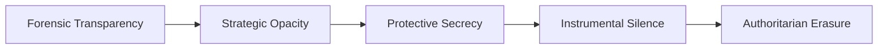
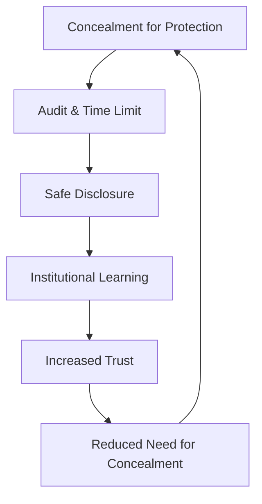

# 🪞 Ethical Censorship Continuum  
**First created:** 2025-11-01 | **Last updated:** 2026-10-28  
*Mapping the moral terrain between concealment for protection and concealment for power.*  

---

## 🛰️ Orientation  

Censorship is rarely absolute.  
Most of the time, it lives on a continuum between care and control — from a single withheld sentence to entire histories excised for convenience.  
This node outlines the ethical spectrum of concealment: when silence protects, when it harms, and when it simply delays accountability.  

The framework draws on Hobbes, Kant, and Bentham, extended through the *Polaris* lens of **survivor voice fidelity**:  
how truth is handled when institutions claim to act in our best interest.

---

## ⚖️ Classical Foundations  

| Philosopher | Principle | Position on Concealment | Modern Resonance |
|--------------|------------|------------------------|------------------|
| **Thomas Hobbes** | Stability through authority | A simplified reading prioritising public order and sovereign authority; **not** a general endorsement of censorship in every circumstance. | Wartime information control, emergency secrecy. |
| **Immanuel Kant** | Duty and universality | A demanding duty of truthfulness; application to privacy, withholding and disclosure requires separate analysis. | Human-rights frameworks, whistleblower ethics. |
| **Jeremy Bentham** | Consequentialism | Consequences matter, but costs, evidence and affected interests must be evaluated rather than assuming a beneficial outcome. | Public-interest tests, national-security exemptions. |
| **Polaris Extension** | Accountability after delay | Concealment tolerated only if fully logged and time-limited. | Survivor voice fidelity; delayed disclosure with audit trail. |

These are **interpretive sketches**, not direct quotations or complete accounts of any philosopher’s position.

---

## 🕳️ Diagram — The Continuum of Concealment  

Censorship becomes unethical not at a single point, but when movement along the line becomes one-way.

---

## 🔥 Applied Ethics — When Concealment Serves Care  

| Scenario | Ethically Permissible If | Polaris Caution |
|-----------|-------------------------|----------------|
| **Operational secrecy** (e.g. active investigation) | Transparency could endanger lives or compromise evidence. | Must include post-event disclosure plan. |
| **Privacy protection** (e.g. victim anonymity) | Silence shields vulnerability, not authority. | Revisit once risk subsides. |
| **Crisis communication gating** | Sequencing truth to prevent panic. | Requires clear sunset clause and independent audit. |
| **Strategic opacity in diplomacy** | Temporary cover for negotiation. | Publish rationale when safe; avoid precedent creep. |

---

## 🪼 When Concealment Becomes Control  

The threshold is crossed when concealment outlives the threat it was meant to neutralise.  
At that point, secrecy stops being protection and becomes **curation of perception**.  
Authoritarian systems thrive here: they treat opacity as asset rather than emergency.  

Soft democracies flirt with the same logic whenever they equate *stability* with *silence*.  
Once moral hygiene becomes brand management, truth is already rationed.

---

## 🐦‍🔥 Survivor Voice Fidelity — Restorative Disclosure  

Polaris adds a post-crisis clause: every **institutionally imposed and reviewable restriction** should carry an accountable reconsideration mechanism. Private information, legally protected identities and consent-based confidences need not become public simply because time passes.  
If the justification was safety, transparency must follow when safety is restored.  
Every restriction imposed in the name of public protection deserves a review plan; eventual disclosure must still respect consent, safety, privacy and statutory protections.

---

## 🫀 The Ethics Loop  

Without the audit stage, the loop collapses into authoritarian inertia.

---

## 🪬 Reflection — The Emotional Logic of Withholding  

Some censorship is defended as an act of care; other restrictions are openly about authority, competitive advantage or coercion.  
Officials convince themselves they are sparing someone — the public, a victim, a reputation — from harm.  
That conviction, even when sincere, breeds blindness: the sense that silence is the same as kindness.  
Polaris argues the opposite: silence is ethical only if it carries a built-in method for its own reversal.

---

## 🧭 Proportionality and Review Test

This continuum is a **normative model**, not a claim that all secrecy can be ranked on one universal scale. Distinguish privacy, confidentiality, evidential preservation, operational security, moderation, and suppression of public-interest criticism; they carry different legal duties and interests.

A defensible institutional restriction should record: **lawful authority**, specific anticipated harm, necessity, less restrictive alternatives, whose speech or data is affected, accountable decision-maker, review date, independent challenge route, and conditions for safe partial or full disclosure. A restriction may remain justified for as long as a concrete risk persists; automatic publication can itself harm survivors.

**Disconfirmation:** a limitation supported by independent review, a narrow scope and demonstrable protection should not be categorised as authoritarian erasure merely because information remains unavailable.

---

## 🌌 Constellations  

🪞 📚 📮 🧠  

---

## ✨ Stardust  

ethical censorship, concealment continuum, survivor voice fidelity, hobbes kant bentham, transparency, strategic opacity, delayed disclosure, institutional ethics  

---

## 🏮 Footer  

*🪞 Ethical Censorship Continuum* defines the moral gradient between protective silence and authoritarian erasure.  

> 
> - [📚 The Banned Book Paradox](../../🪄_Expression_Of_Norms/🎶_Banned_Broadcasts_Cooperative/📚_banned_book_paradox.md)  
> - [🤭 Who Is Scared of The Internationale?](../../🪄_Expression_Of_Norms/🎶_Banned_Broadcasts_Cooperative/🤭_who_is_scared_of_the_internationale.md)
> - [🧿 Canonisation by Erasure](../../🪄_Expression_Of_Norms/🎶_Banned_Broadcasts_Cooperative/🧿_canonisation_by_erasure.md)  
> - [📊 Navy Transparency as Resistance](../../🪄_Expression_Of_Norms/🎶_Banned_Broadcasts_Cooperative/data/📊_navy_transparency_as_resistance.md)  
> - [🫀 Pathologising Sensitivity as Containment](../../../Containment_Scripts/Suppression_Modes/🫀_pathologising_sensitivity_as_containment.md)  

*Silence without expiry is not ethics; it’s inertia disguised as care.*

_Last updated: 2026-10-28_

*Survivor authorship is sovereign. Containment is never neutral.*
