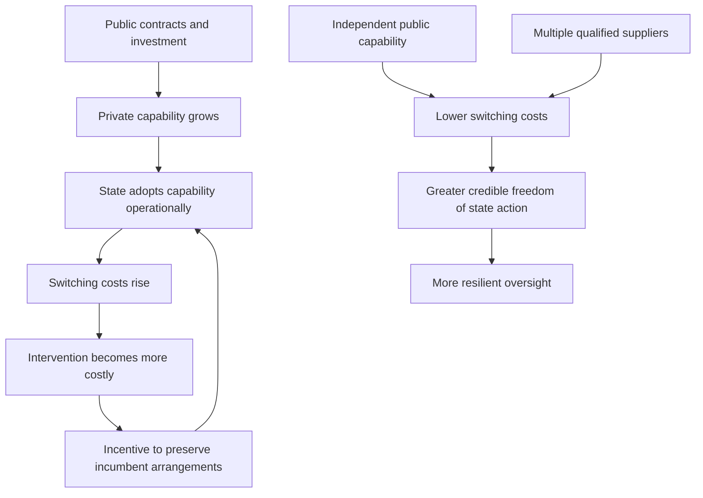

<!-- it is struggling with this one almost as much as it struggled with chirality and cow placentas 

I obviously cannot possibly imagine why.-->  

# 🚀 Nationalise Lady Catherine And Her Rockets Already
**First created:** 2026-10-25 | **Last updated:** 2026-10-25  
*His Ladyship has rockets, satellites, a defence customer, an artificial-intelligence business and rather strong opinions about who is entitled to tell whom what to do. The American republic may wish to review its arrangements.*

---

## 🛰️ Orientation

Lady Catherine de Bourgh has always been quite clear that her opinions ought to carry the force of law. The difficulty is that Jane Austen gave her neither Parliament nor an army. She had Rosings Park, considerable money, a talent for arriving uninvited and a remarkable conviction that Elizabeth Bennet was obliged to answer her questions.

Now suppose His Ladyship acquires a rocket company.

Not a toy rocket company. A company supplying launches for American national-security missions; a satellite communications enterprise; an artificial-intelligence developer; and an interconnected set of commercial interests whose financing, regulation, customers and political environment all matter. Suppose, furthermore, that the principal assets and corporate structures remain within reach of American law.

The question ceases to be whether Lady Catherine has the right to express an opinion. Of course she does. The question is **whether the state has made itself dependent on capabilities whose operation, financing and governance remain substantially subject to private decisions**.

The title is deliberately provocative. It is not a finding that nationalisation is legally required, that Musk has committed an offence warranting expropriation, or that government officials are secretly preparing a takeover. It is a demand to examine the full range of lawful options, including public ownership, rather than treating an extraordinarily powerful supplier's continued private control as a fact of nature.

**The thesis:** *A state can retain the legal authority to regulate strategic infrastructure while losing some of the practical freedom to exercise that authority if it has organised its own operations around a concentrated private dependency.*

This is an **Observation Becomes Intervention** node. It is about what happens when the contractor, the state, investors, allies, regulators and adversaries observe one another, change their expectations, and then act on those expectations.

---

## 🪭 1. A Note on His Ladyship

For purposes of the literary conceit, Elon Musk plays Lady Catherine de Bourgh: **His Ladyship**. In factual reporting he is Elon Musk, *he/him*. His Ladyship is a theatrical character, not a statement about Musk's gender identity. The satire is directed at status, presumed authority and control over other people's choices; femininity is not the insult. His Ladyship may be exceptionally pretty. The gowns may be magnificent. The rockets still require governance.

Elizabeth Bennet plays the person who asks whether an asserted entitlement has any actual basis. The **Admiralty** is a deliberately Austenian shorthand for the American defence establishment, not an assertion that any identifiable military officer privately shares the author's views. **The Assembly** is Congress; **the solicitors** are the constitutional lawyers and courts; **the neighbours** are other countries that have acquired an interest in whether the satellites continue to work.

> **HIS LADYSHIP:** I am a private individual.  
> **ELIZABETH:** Of course, ma'am.  
> **HIS LADYSHIP:** With private businesses.  
> **ELIZABETH:** Naturally.  
> **HIS LADYSHIP:** Which are essential to national defence.  
> **ELIZABETH:** That does seem to complicate matters.  
> **HIS LADYSHIP:** THERE IS NO COMPLICATION.  
> **ELIZABETH:** Then I am sure the Admiralty will be relieved.

### The Austen mechanism

In *Pride and Prejudice*, Lady Catherine seeks a categorical assurance that Elizabeth will not marry Darcy. Elizabeth refuses. Lady Catherine conveys that resistance to Darcy, who interprets it differently from her: **“It taught me to hope.”** Lady Catherine's attempted intervention becomes information for another observer and helps produce a result she did not intend.

The companion Polaris node, [*Austen Cybernetics 103: Lady Catherine's Interview Technique*](../♻️_Cybernetics/🧬_Start_Here/🪭_austen_cybernetics_103.md), develops the principle: **information does not contain its interpretation**. The same observation has different value to actors with different prior knowledge, interests and decision-making responsibilities.

Our extension: **the state's failure to intervene publicly, its continuing procurement, a supplier's public statements, and investors' responses all become signals**. Those signals may be read differently by each participant. Some readings will be wrong. They may nevertheless alter behaviour.

---

## 👑 2. The Sovereign Who Is Not One

Musk is not a sovereign. A private corporate group does not acquire a general power to legislate, tax, adjudicate or command American armed forces by becoming valuable to the government. Contracts are not commissions as Commander-in-Chief. A communications network is not a territory. Corporate influence is not a constitutional office.

But the absence of sovereign *status* does not settle the question of sovereign-*like effects*.

A privately controlled system may determine whether a customer can access communications, whether a service can be maintained in a region, how quickly essential capacity can be expanded, or how costly it would be to replace an incumbent supplier. Those powers are constrained by law, contracts, technical architecture and competition. They may nonetheless have geopolitical consequences.

It is the **combination** that deserves attention: launch capability; satellite infrastructure; government procurement; AI systems; social-media distribution; access to capital; and public political influence. Not all of these belong to the same legal entity, and none should be casually attributed to the others. But investors and public institutions may reasonably examine how common control, contractual relationships and organisational integration affect risk.

The relevant question is not whether His Ladyship has become a king. It is whether **a republic can maintain operational autonomy where essential functions depend on a supplier with unusually concentrated cross-domain leverage**.

---

## 🏭 3. The Estate: What Is Actually American?

The United States is not confronting a remote foreign sovereign whose assets lie wholly outside domestic jurisdiction. SpaceX's own 2026 SEC registration material states that Space Exploration Technologies Corp. was incorporated in Delaware in 2002, reincorporated in Texas in February 2024, and maintains its principal executive offices in Starbase, Texas. The filing describes xAI as acquired by SpaceX in early 2026 and integrated into its broader AI operations. [S1]

That is a stronger evidentiary starting point than a generic claim that the companies are “American”. **Incorporation, principal place of business, location of physical assets, ownership of intellectual property, regulatory jurisdiction and control of overseas subsidiaries are separate questions.** The answer to one does not answer all the others.

Tesla is a US-based, publicly traded company; its financial exposure is not identical to that of a privately financed enterprise. SpaceX's financing and corporate disclosures require examination in light of its 2026 securities filings. X, xAI, Starlink and Starshield must be described using the **actual contemporaneous corporate structure**, not assumed to be free-standing corporations merely because their product names are familiar. [S1]

An American legal connection gives federal and state institutions significant tools: corporate law, litigation, procurement, securities regulation, competition law, licensing and physical jurisdiction. **It does not automatically give the executive a right to seize the company.**

> **HIS LADYSHIP:** I operate internationally.  
> **ELIZABETH:** Your Texas incorporation is a charming domestic detail.  
> **HIS LADYSHIP:** MY AMBITIONS TRANSCEND BORDERS.  
> **ELIZABETH:** Your registered agent may still receive the correspondence.

---

## 🛰️ 4. The Rockets Are a Defence Relationship, Not a Metaphor

On 4 April 2025 the US Space Force announced National Security Space Launch Phase 3 Lane 2 contracts for SpaceX, United Launch Services and Blue Origin. The anticipated contract values were approximately **$5.92 billion**, **$5.37 billion** and **$2.39 billion** respectively. The Defense Department's contract announcement describes SpaceX's award as an indefinite-delivery requirements contract covering launch and associated mission services through an expected April 2033 completion date. These are **contract ceilings/anticipated values, not evidence that the entire amounts have been paid**. [S2][S3]

That establishes something concrete: the government has deliberately integrated SpaceX into a national-security launch architecture. It also establishes something sometimes lost in polemic: **other suppliers exist within that procurement programme**. Whether they are technically and operationally interchangeable for any particular mission requires a mission-specific assessment.

### What a proper dependency audit would separate

| Capability | Question that matters | What must not be assumed |
|---|---|---|
| National-security launch | Can a particular payload be launched on schedule by an alternative certified provider? | That every rocket is interchangeable. |
| Commercial satellite communications | Who can authorise, sustain, modify or interrupt a contracted service? | That commercial ownership equals unilateral military command. |
| Government-oriented satellite services | What access, security, continuity and operational rights are contractually established? | That marketing descriptions reveal classified arrangements. |
| Ground infrastructure | Who owns, operates and maintains gateways, terminals and support systems? | That acquiring a ground station acquires a constellation. |
| Software and intellectual property | Could the government operate or maintain systems without supplier cooperation? | That physical possession conveys usable source code and know-how. |
| Industrial base | How quickly could launch and satellite capacity be replaced? | That a congressional appropriation can manufacture skilled workers overnight. |

**Military-enabling infrastructure is not the same as private possession of military command authority.** It is nonetheless capable of becoming an operational bottleneck.

A supplier may be excellent at delivering a service while its success increases the cost of substitution. That is not a moral contradiction. It is a system-design problem.

### 4.1 What breaks if His Ladyship says no?

A useful audit cannot begin with the question, *is SpaceX indispensable?* That question is too broad to be answered honestly. A national-security launch, a communications terminal, a classified payload, a gateway, a satellite-control interface and a manufacturing production line are not interchangeable things. Each has a different supplier market, substitution time and degree of government control.

| Dependency to test | Evidence already visible | Unknown that determines exposure | Possible mitigation |
|---|---|---|---|
| **National-security launch** | The Space Force's 2025 Lane 2 awards include SpaceX, ULA and Blue Origin. [S2][S3] | Mission-by-mission certification, capacity, schedule and switching costs. | Multi-provider launch assignments, qualification and spare capacity. |
| **Military use of commercial connectivity** | SpaceX operates a satellite communications business; specific government access arrangements are not established by the launch awards. | Who controls service changes, outages, terminals, geographic access and escalation? | Contracted continuity, technical redundancy and independent fallback. |
| **Government-oriented satellite products** | Product labels alone do not disclose government ownership or operational rights. | Which assets, keys, ground stations, data and software the government may control. | Audited rights, government-owned elements or alternative networks. |
| **Launch and satellite industrial base** | SpaceX supplies major launch services. | Time to train, certify and equip an alternative production and operations workforce. | Sustained industrial-base investment, not merely emergency appropriation. |
| **Data, software and maintenance** | Public contract headlines rarely establish all technical rights. | Source access, interface documentation, cybersecurity controls and continuity after supplier failure. | Negotiated technical-data rights, escrow where suitable, open interfaces and tested transition plans. |

**No row in this table establishes that Musk could unilaterally shut down an American military mission.** It identifies what would have to be shown before asserting that he could—or that the government has already eliminated that risk. The relevant unit of analysis is the *mission and its dependencies*, not the billionaire and his press coverage.

The Admiralty should be asked for a **mission-specific continuity matrix**: responsible public authority; supplier; contractual control; technical control; substitutes; time to substitute; cost of failure; and the source of assurance. Classified answers may need classified oversight. Their absence from the public record is not proof of their absence inside government.

> **THE ADMIRALTY:** We have three launch providers.  
> **ELIZABETH:** Excellent. Are they interchangeable for the mission in question?  
> **THE ADMIRALTY:** That depends on the mission.  
> **ELIZABETH:** Then we have found the beginning of the assessment, gentlemen, not its conclusion.

---

## ⚔️ 5. War, Continuity and the Problem of Timing

The Iran-related security environment is relevant to this analysis, but a specific claim that a particular SpaceX service has been decisive in a particular operation requires independent operational evidence. The public sources used here do **not** establish the precise current contribution of SpaceX to any October 2026 Iran campaign. That question remains open rather than being supplied by dramatic inference.

The general mechanism is robust:

1. Military operations increase the value of reliable communications, launches, sensing and resilient infrastructure.
2. A proven supplier becomes more valuable when time is short.
3. The state may simultaneously become more concerned about concentration risk.
4. Abruptly disrupting the supplier can create the very operational vulnerability officials are trying to prevent.
5. Short-term continuity can therefore be prioritised even while long-term diversification is necessary.

**Wartime can increase both the incentive to constrain a strategic supplier and the cost of doing it badly.**

The sensible question is not “why hasn't the Admiralty stormed the factory?” It is whether there are tested continuity arrangements, lawful step-in rights, alternative capacity, public technical competence and decision-making channels that do not depend on a single person's cooperation.

A government that discovers those questions only after a service interruption has been doing its paperwork in the wrong order.

---

## 💸 6. Wall Street, Washington and the Cost of Being Indispensable

The American state has instruments between doing nothing and buying the rockets.

**Hard legal powers:** enforce securities law; challenge unlawful mergers or monopolisation; impose lawful procurement requirements; investigate contractor responsibility; pursue suspension or debarment where the legal standards are met; legislate; fund competing suppliers; and acquire specified property under applicable law.

**Legitimate signalling and market effects:** announce competitive procurement, fund alternative industrial capacity, publish substantiated oversight findings, disclose contracting priorities and explain new standards. Investors may change their valuation of a business when the sovereign customer credibly changes its purchasing behaviour.

This is **not** a licence for officials to manipulate securities markets, threaten baseless enforcement, or punish an owner for protected political speech. State leverage is powerful precisely because it must be exercised through identifiable lawful purposes and procedures.

The financial system adds a second feedback loop:

- The state funds or purchases strategic capability.
- Investors price in the apparent durability of government demand.
- The supplier's valuation and access to finance improve.
- The supplier expands and becomes harder to replace.
- The state faces larger economic and operational consequences if it changes course.

This is a **possible mechanism**, not a claim that the entire valuation of SpaceX or Tesla is caused by government contracts.

### 6.1 His Ladyship has investors, unfortunately

**Wall Street is a transmission mechanism, not a magic button.** Public-market investors, private funds, banks, lenders, insurers and government procurement officers respond to different information and are constrained by different duties. The state can alter expected commercial conditions by **lawfully changing its own procurement and industrial policy**; it cannot lawfully manufacture allegations or weaponise regulatory discretion merely to damage a disfavoured person's valuation.

| Financial channel | Lawful state action | Potential market transmission | Evidence needed before claiming an effect |
|---|---|---|---|
| Government revenue | Diversify awards, modify future competitions within procurement law | Changes expected revenue concentration | Contract revenue and pipeline by entity |
| Capital markets | Enforce disclosure and anti-fraud requirements | Changes information available to investors | Specific filings, obligations and materiality |
| Competition | Investigate legally cognisable anticompetitive conduct or mergers | Changes transaction probability and structure | Actual proposed deal, market definition, statutory test |
| Industrial policy | Invest in substitutes, capacity and certification | Changes long-term competitive landscape | Appropriations, timelines, technical feasibility |
| Contractor eligibility | Apply responsibility, suspension or debarment rules with process | Changes ability to compete for particular awards | Agency authority, factual predicate, due process |
| Government acquisition | Negotiate purchase or seek legislative acquisition authority | Changes ownership and compensation expectations | Identified assets, valuation and legal basis |

**Tesla is publicly traded; SpaceX's investor structure and 2026 securities position must be established from contemporaneous records.** A share-price movement is not evidence that an agency deliberately engineered it. Nor is a government contract automatically an equity subsidy. Financial leverage needs a traceable mechanism: *who acts, under what authority, on which asset, and with what demonstrable result?*

An especially important research question is **the public contribution to private enterprise value**. Which capabilities were funded by public purchases, government research, infrastructure, preferential access or general industrial policy? The answer matters to political debate about public ownership, but it does **not** extinguish private shareholders' compensation rights.

> **HIS LADYSHIP:** Wall Street understands my genius.  
> **ELIZABETH:** Wall Street also reads the government's procurement forecasts, ma'am.  
> **HIS LADYSHIP:** MY FINANCIAL AFFAIRS ARE PRIVATE.  
> **ELIZABETH:** Some of them. The government's appropriations are rather more public.

### The corporate-governance wrinkle

Reuters reported in February 2026 that SpaceX acquired xAI in a transaction combining the rocket and satellite business with the developer of Grok; SpaceX's later SEC filing also describes the acquisition. [S1][S4] Any further claims about **Tesla–SpaceX mergers, independent committees, voting arrangements or proposed transactions in October 2026** require the specific contemporaneous documents. They are not established merely by a previous discussion of rumours.

When a controller publicly favours an outcome, observers may question an ostensibly independent decision process. That is not proof that a committee lacked independence. It is a reason to distinguish **substantive independence, observable independence and perceived independence**.

> **HIS LADYSHIP:** The committee is entirely independent.  
> **ELIZABETH:** How reassuring.  
> **HIS LADYSHIP:** I have explained to everyone what the correct decision is.  
> **ELIZABETH:** I see.  
> **HIS LADYSHIP:** AND I SHALL BE MOST SURPRISED IF THEY DISAGREE.  
> **ELIZABETH:** I believe the observers have learned something, ma'am.

---

## 🤖 7. Grok, Sexualised Images and the Limits of Corporate Compartmentalisation

The safeguarding record belongs here because it tests whether cross-domain ownership creates governance questions that ordinary institutional silos fail to address. **It must not be reduced to a joke about investor sentiment.** Women and children subjected to non-consensual sexualised imagery are not props in a debate about rockets.

In January 2026, the UK's Ofcom opened a formal investigation into X concerning Grok-related sexualised imagery, including reports of imagery involving children that **might** constitute child sexual abuse material. The UK's Information Commissioner's Office announced investigations in February into data processing associated with Grok. California's Attorney General announced an investigation in January. These were investigations, not convictions or blanket judicial findings. [S5][S6][S7]

In June 2026, Canada's Privacy Commissioner **did** publish a finding that X Corp. and xAI had violated federal private-sector privacy law in connection with the production of non-consensual sexualised deepfakes. The report distinguished CSAM from non-consensual intimate imagery and declined to adopt a precise total volume for the two categories. That distinction matters. [S8]

Different institutions see different risks:

- A child-safety authority asks whether unlawful imagery was generated, distributed, reported and removed.
- A privacy regulator asks whether personal information was lawfully processed.
- A defence customer asks whether its contractor can reliably meet security and performance obligations.
- An investor asks about governance, liability, disclosure and future cash flows.
- A competition authority asks about market structure and legally cognisable competitive effects.

One regulator's findings do not automatically satisfy another institution's legal test. Equally, **organisational integration can make it unreasonable to pretend that governance concerns exist in hermetically sealed universes**.

The correct method is a crosswalk of **entity → conduct → evidence → legal duty → responsible institution → available remedy**. It is not guilt by association.

### 7.1 The safeguarding crosswalk: whose duty, whose finding?

| Entity or institution | Question it must answer | Evidentiary boundary | Possible remedy category |
|---|---|---|---|
| **X / platform operator** | What content was distributed, reported, restricted or removed, and what duties apply? | A regulator opening an investigation is not a finding of liability. | Platform compliance, enforcement, judicial relief where authorised. |
| **xAI / model developer** | What systems generated outputs, what safeguards existed, and what personal data was processed? | Separate generated non-consensual intimate imagery from legally defined CSAM. | Product safeguards, privacy compliance, applicable enforcement. |
| **Relevant parent or controlling entities** | What governance, reporting and control responsibilities actually attach? | Common ownership does not erase corporate separateness. | Corporate governance and remedies grounded in the relevant law. |
| **Child-protection and privacy regulators** | What violations can they prove under their respective statutes? | Their legal mandates and thresholds differ. | Investigations, findings, orders and penalties as law permits. |
| **Defence contracting authority** | Do substantiated facts engage a specific responsibility, security or contractual standard? | An unrelated allegation is not automatic grounds for exclusion. | Contract administration or eligibility decisions with procedural protections. |

This crosswalk should be updated when investigations conclude or corporate entities change. **No inference of guilt travels automatically from one column to another.** Nor should organisational complexity be allowed to erase the question of who could prevent foreseeable harm.

---

## 🏛️ 8. The Government of the Day Is Not the State

A presidential administration is not identical to the entire American constitutional order. The executive branch itself contains operational, legal, procurement and intelligence responsibilities that are not reducible to the President's personal relationships. Congress legislates and appropriates. Courts review legal authority. State regulators may have separate jurisdiction.

Three kinds of alignment must be kept apart:

1. **Political alignment:** supporting politicians, positions or electoral outcomes.
2. **Operational alignment:** providing services that advance a government mission.
3. **Institutional alignment:** preserving the state's long-term independence, accountability and capacity to act.

A person or company may be politically favoured and operationally useful while still generating institutional concentration risks. Conversely, disagreement with an administration does not by itself make a contractor a national-security threat.

> **A private actor may be politically aligned with the government of the day while creating strategic dependencies that constrain the state itself.**

This is not an allegation about what particular Pentagon officials privately believe. The public procurement record demonstrates that SpaceX is important to defence acquisition. It does not establish the Admiralty's private emotional temperature.

> **HIS LADYSHIP:** The President appreciates my rockets.  
> **ELIZABETH:** How gratifying.  
> **HIS LADYSHIP:** Therefore the Admiralty approves of everything.  
> **ELIZABETH:** Has the Admiralty said so?  
> **HIS LADYSHIP:** THE PRESIDENT HAS.  
> **ELIZABETH:** That was not quite my question.

### Campaign spending and international courts

Political contributions, public endorsements, and public positions concerning the International Criminal Court may be relevant to mapping incentives. They do not, without additional evidence, establish coordination, a quid pro quo or the cause of any particular policy decision. US opposition to some ICC jurisdictional claims predates Musk's recent political involvement. The node should preserve the research question without manufacturing the answer.

---

## 👁️ 9. The Curious Absence of a Public Confrontation

The United States has a long and sometimes disturbing history of using extraordinary coercive power against perceived threats. The examples are not morally or legally interchangeable: Truman's steel seizure (1952); the Philadelphia MOVE bombing (1985); Ruby Ridge (1992); Waco (1993); the Iraq invasion (2003); Bundy Ranch (2014); and the Malheur occupation (2016) involve radically different facts, institutions, powers and outcomes.

They are useful here **only** for a bounded comparative question: *how do American institutions decide that concentrated power constitutes a threat requiring intervention, and how do they decide which forms of intervention are legitimate?*

Some interventions were excessive or disastrous. They are not precedents for violent action against a businessman. Indeed, the history argues for the opposite: **lawful, proportionate, accountable action with genuine evidentiary thresholds**.

The interesting contrast is the visible public record. If the government has substantial regulatory, financial, procurement and legislative tools, why is there not more publicly legible discussion of public control or sovereign alternatives for strategic infrastructure?

Possible explanations must remain hypotheses:

| Hypothesis | Observable evidence that would help |
|---|---|
| Existing safeguards are considered adequate | Published procurement safeguards, oversight conclusions, audits |
| Switching costs are high | Supplier concentration data, certification timelines, replacement costs |
| Political accommodation | Documented decisions, communications and lawful financing records |
| Legal thresholds are unmet | Statutory requirements, judicial decisions, enforcement records |
| Public acquisition is judged impractical | Cost estimates, transition plans, legislative assessments |
| Non-public contingency planning exists | Later declassifications, authorised testimony, released documents |
| Government prefers diversification | New awards, industrial investments, alternative capacity |

**No visible confrontation does not prove no private discussion.** Nor does silence prove secret institutional opposition, conspiracy or helplessness. But observable restraint is information. It changes what investors, allies, adversaries and suppliers may believe the state will tolerate.

A cybernetic observer should ask what those beliefs do next.

### 9.1 America has not always waited for certainty

The following comparison is about **thresholds, state capacity and accountability**, not about equivalence between a defence contractor and an armed standoff. Each case needs its own legal and historical source before a detailed causal claim is published.

| Case | Type of perceived problem | State response | Why it matters here—and why the analogy stops |
|---|---|---|---|
| **Truman steel seizure, 1952** | Threatened interruption to wartime industrial production | Executive seizure order, then judicial rejection in *Youngstown* [S12] | Direct example of an asserted national-security rationale outrunning executive authority. |
| **MOVE, Philadelphia, 1985** | Police confrontation with an armed communal organisation | Police dropped an explosive device; fire and deaths followed | Illustrates catastrophic, disproportionate domestic force; no model for corporate regulation. |
| **Ruby Ridge, 1992** | Federal law-enforcement operation | Deadly confrontation, later investigations and litigation | Shows why state claims of threat must be independently scrutinised. |
| **Waco, 1993** | Federal firearms investigation and siege | Federal tactical intervention, deaths and extensive review | Raises proportionality and decision-making questions, not corporate acquisition authority. |
| **Iraq, 2003** | Claimed national-security threat involving weapons | Invasion followed by major scrutiny of intelligence claims | Illustrates the danger of intervention based on unsound premises; wholly different legal regime. |
| **Bundy Ranch, 2014** | Federal land-management dispute and armed resistance | Enforcement confrontation and later proceedings | Shows contested choices around enforcement and escalation. |
| **Malheur, 2016** | Armed occupation of federal property | Federal response, arrests and trials | Shows a different combination of restraint, coercion and legal process. |

A careful comparison would also examine **race, political status, media framing and institutional incentives**; those factors cannot be inferred from this table alone. Most importantly, past overreach is a reason to demand better evidence and more accountable methods—not to advocate similar overreach against Musk.

The narrower research question survives: **why does the American state visibly mobilise different kinds of power against different kinds of perceived threat, and which explanations are actually documented?**

---

## ⚖️ 10. Can America Actually Take the Rockets?

**Yes, potentially, through lawful acquisition; no, not simply because the President is annoyed.** There is a spectrum between priority orders and outright public ownership.

### 10.1 The Defense Production Act

Under **50 U.S.C. § 4511**, the President may require qualifying national-defence contracts to take priority and may allocate specified materials, services and facilities subject to statutory conditions. The statute expressly excludes contracts of employment from its priority-order mechanism. It is powerful industrial coordination authority, **not a general corporate-nationalisation clause**. [S9]

### 10.2 Federal property acquisition

**10 U.S.C. § 2663** authorises military condemnation of specified interests in land for particular purposes, with procedural requirements and limitations; **§ 2664** restricts acquisition of real property without express legal authorisation. These provisions cannot be read as a ready-made authority to take every share, satellite, software repository and subsidiary belonging to SpaceX. [S10][S11]

### 10.3 Congress, public use and compensation

The **Fifth Amendment** requires just compensation for property taken for public use. Congress could consider legislation authorising a public acquisition programme, specifying its purpose, scope, funding, governance and process. Compulsory acquisition of a functioning corporate enterprise would raise difficult questions of constitutional authority, compensation, due process, valuation, creditors, minority shareholders, contracts and international obligations. A statute would not automatically survive every challenge merely because its supporters invoked national security.

A voluntary purchase of defined assets or interests is a different route. So is a government-funded replacement system. **Nationalisation is one possible ownership structure, not the only means of obtaining operational independence.**

### 10.4 The steel-mill warning: *Youngstown*

In **Youngstown Sheet & Tube Co. v. Sawyer, 343 U.S. 579 (1952)**, the Supreme Court rejected President Truman's attempt to seize steel mills during the Korean War without sufficient legal authority. The government considered steel essential to defence production; that did not give the President a free-standing power to take the industry. [S12]

This is the constitutional indignity awaiting His Ladyship *and* any President who imagines that being Commander-in-Chief means being able to acquire a company by announcement.

> **HIS LADYSHIP:** You cannot nationalise my rockets.  
> **ELIZABETH:** Not without the appropriate legal authority, ma'am.  
> **HIS LADYSHIP:** THEN I AM SAFE.  
> **ELIZABETH:** I wouldn't presume to speak for Congress.

### 10.5 What about securities and antitrust?

The SEC enforces securities law; it does not possess a general power to confiscate a company because its controller is controversial. Competition authorities can challenge conduct or transactions where the legal tests are met; a remedy requiring divestiture is not synonymous with government ownership. Procurement agencies can exercise contractual and statutory remedies, but their powers depend on the applicable instruments and facts.

The serious proposal must identify **the specific legal basis for each specific action**.

### 10.6 The government is not merely a customer

Federal procurement is a system of public authority exercised through contracts, statutes and regulations. Before anyone reaches for compulsory acquisition, the Admiralty should examine its actual contractual and regulatory toolkit.

| Tool | What it might secure | Limit |
|---|---|---|
| **Responsibility determinations** | Assessment of whether an offeror can meet lawful award standards | Must use applicable criteria and evidence; not a general personality test. |
| **Suspension and debarment** | Protection of federal procurement interests where legal grounds exist | Procedural rules and evidentiary standards apply; neither is an automatic punishment for unrelated allegations. |
| **Termination and remedies** | Contractual response to default or lawful convenience termination | Contract terms, compensation and continuity consequences matter. |
| **Security requirements** | Defined protection of facilities, information, personnel and systems | Specific obligations and authorities must be established. |
| **Technical-data and software rights** | Access needed for maintenance, competition or transition | Rights depend on contract clauses, funding and negotiated terms. |
| **Change-of-control provisions** | Review of legally relevant ownership or organisational changes | Cannot assume every contract gives an unrestricted veto over a merger. |
| **Government-furnished property** | Retained public ownership of defined equipment or assets | Ownership of one asset does not confer ownership of the whole service. |
| **Transition and continuity planning** | Reduced risk of interruption if a supplier fails or exits | Requires practical substitutes, tested interfaces and trained people. |

These are **possible instruments**, not findings that particular SpaceX agreements contain particular clauses. The Federal Acquisition Regulation and applicable defence supplements provide the starting framework; the actual contract and classified annexes, if any, determine what is available in a given case. See the official [Acquisition.gov FAR](https://www.acquisition.gov/browse/index/far) and [DFARS](https://www.acquisition.gov/dfars) for the regulatory framework. [S13][S14]

**A credible threat to exercise lawful contractual rights is different from an unlawful threat to punish an owner for speech or politics.** The first can protect public capability; the second would corrode the constitutional independence the intervention purports to defend.

---

## 🏗️ 11. Nationalise What, Exactly?

A policy paper that says “nationalise SpaceX” without specifying the operational capability has not finished its homework.

| Intervention | What it might secure | What it does not automatically secure |
|---|---|---|
| Stronger contracts and continuity terms | Enforceable obligations and remedies | Independent ability to operate systems |
| Government-held technical access and licences | Defined rights to maintain or use technology | Skilled workforce or independent infrastructure |
| Supplier diversification | Reduced single-supplier exposure | Immediate replacement capacity |
| Publicly owned satellite capability | A separate communications asset | Global coverage or mature operations overnight |
| Targeted purchase of facilities or systems | Ownership of particular assets | Complete end-to-end capability |
| Acquisition of a business line | A broader operational unit | Easy separation from shared systems and debt |
| Full corporate acquisition | Public ownership and potential unified control | Good governance, technical competence or low cost |

A proper assessment would ask what the United States needs to be able to do **without the continuing consent of any single private owner**. Then it would work backwards to the minimum sufficient rights, infrastructure, people and funding.

If the answer is an independent military satellite communications capability, acquiring a rocket company may be unnecessary or insufficient. If the answer is assured launch capacity, owning satellites does not solve it. If the answer is safeguarding failures in an AI product, taking possession of launch facilities is beside the point.

### Who pays?

A lawful compulsory taking ordinarily entails compensation; a voluntary purchase entails a negotiated price. Valuation would have to account for what is actually being acquired, not a headline market figure treated as a cheque payable on demand. Public financing of a company's development is relevant to political debate but does not simply erase its owners' property rights.

### Who operates it?

People, software, certification, supply chains, security clearances, licences, maintenance and institutional memory matter. A government can purchase a rocket and still lack the capability to launch it safely.

**The Admiralty would ideally like both the rockets and the people who know which end points upwards.**

---

## ♻️ 12. The Dependency Loop

This is a **hypothesis-generating model**, not proof that SpaceX has coerced the government. Each arrow requires a measurable proposition.

- **Public investment → capability:** trace contracts, grants, facilities, procurement and privately financed development.
- **Capability → dependence:** identify missions, substitutes, failure modes and time-to-replacement.
- **Dependence → intervention cost:** estimate continuity, legal, market and national-security costs.
- **Cost → accommodation:** seek actual decisions, not impressions of officials' private thoughts.
- **Alternatives → freedom:** measure whether redundancy changes procurement options and operational resilience.

The model is especially important because a dependency trap does **not** require an evil mastermind. It can arise from individually sensible procurement decisions that accumulate into a strategically awkward whole.

The state may have bought excellent services. The problem is discovering that it did not also buy enough freedom of manoeuvre.

---

## 🧿 13. Observation Becomes Intervention

Here is where Lady Catherine returns to the centre of the analysis.

She does not merely watch Elizabeth. She questions her. The questioning changes what Elizabeth says and what Darcy subsequently learns. Lady Catherine is an actor inside the system she imagines herself observing from above.

Now transpose the mechanism:

| Observer | Observation | Possible interpretation | Potential intervention |
|---|---|---|---|
| Supplier | Government continues buying | Demand is durable; switching is difficult | Invest, bargain, expand |
| Military planner | Supplier performs well | Capability is valuable; continuity is vital | Renew contracts, develop contingencies |
| Investor | Government continues buying | Revenue and strategic relevance appear durable | Reprice risk, finance expansion |
| Regulator | Evidence of potential violations | Statutory inquiry may be warranted | Investigate, enforce where justified |
| Ally | US capability uses commercial infrastructure | Allied exposure may exist | Seek guarantees or alternatives |
| Adversary | Concentrated infrastructure is visible | A possible dependency exists | Study vulnerabilities or signalling |
| Congress | Multiple institutions rely on one supplier | Oversight or legislation may be warranted | Hearings, appropriations, statutory reform |

The observations are not interchangeable. The observers do not share the same duties, information or incentives. **A procurement renewal is not a declaration that the supplier is above the law. An investigation is not a conviction. A political endorsement is not a military command.**

But each event becomes part of the environment in which others act.

This is the second-order question: **what does His Ladyship believe the government believes His Ladyship can do, and what does the government believe His Ladyship believes the government will tolerate?**

The sentence is ridiculous. The feedback loop is not.

## 🪭 13A. The Book Girlies Have Seen This Character Before

This is not an ornamental literary comparison. It is a **method for noticing informal authority**—especially authority that appears nowhere in the legal chart because it survives in the expectations and habits of the people around it.

Lady Catherine does not need a statute empowering her to instruct Elizabeth Bennet. She needs the surrounding society to treat her instructions as socially binding. Her power is partly an achievement of other people's anticipatory obedience. Elizabeth's refusal is revealing because it asks an extraordinarily simple question: *on whose authority?*

That is the social-system literacy the book girlies bring to the defence men. The defence men can model launch cadence, encryption, supplier concentration and mission assurance. The book girlies can ask what happens **before** the formal decision: who is presumed entitled to enter the room, to demand the information, to declare the acceptable outcome, or to make refusal feel impossibly expensive?

| The novel's social observation | The institutional question it suggests | Evidence that could answer it |
|---|---|---|
| Lady Catherine expects deference | Are supplier preferences being treated as obligations without legal basis? | Actual decisions, contract terms and recorded exceptions. |
| She invokes status and connections | Are political relationships mistaken for authority over agencies? | Decision records, delegation and oversight. |
| She demands Elizabeth's information | What data or access may a supplier lawfully require? | Access-control rules and contractual rights. |
| She announces the correct outcome | Can committees and officials decide independently? | Composition, recusal, process and contrary decisions. |
| Elizabeth refuses the premise | Has an institution demonstrably said no? | Denied requests, competed awards, enforced standards, litigated disputes. |
| Darcy reads the encounter differently | Do investors, agencies and allies interpret the same signal differently? | Contemporaneous reactions, not retrospective mind-reading. |

**Has anybody told His Ladyship no?** This is a research question, not an insinuation that the answer must be no. A documented refusal that sticks would be meaningful *counterevidence* against a claim of unlimited private power. So would robust substitution capability or enforceable technical control. We should actively look for such evidence rather than treating every fact as confirmation of the thesis.

The literature contributes a second lesson: **Lady Catherine's attempt to control the interpretation of an event is itself an event to be interpreted.** The actor's public certainty about a committee, a regulator or a government relationship can change how observers assess its independence. That does not prove misconduct. It changes the information ecology.

> **THE ADMIRALTY:** We have assessed His Ladyship's formal authority.  
> **ELIZABETH:** Excellent. And his informal authority?  
> **THE ADMIRALTY:** His what?  
> **ELIZABETH:** Who feels able to refuse him?  
> **THE ADMIRALTY:** We should consult the relevant departments.  
> **ELIZABETH:** Oh, gentlemen. The book girlies have seen this character before.

---

---

## 🌐 14. Sovereignty Is More Than Having the Right Statute

The United States has territorial jurisdiction, legislative power, regulatory institutions, defence procurement, enormous capital-market influence and the capacity to build public infrastructure. Those powers are real. They are not infinite, and they are not all vested in the same official.

A strategically mature state must also preserve the **practical capacity** to use its lawful powers without destroying the operations those powers exist to protect.

That may mean buying assets. It may mean buying fewer services from one company. It may mean financing competitors, negotiating technical access, building public systems, requiring interoperable standards, or accepting that some commercially efficient arrangements are institutionally too brittle.

Nationalisation has costs and risks of its own. Public ownership can concentrate political control, impair innovation, invite patronage or create new single points of failure. Those objections deserve serious examination. **A publicly owned monopoly with no oversight is not automatically a triumph of democratic accountability.**

The strongest version of the argument is therefore not *nationalise because His Ladyship is irritating*. It is:

> **The American state should be able to demonstrate how it preserves independent control of capabilities essential to national defence, and it should be willing to consider public acquisition where lesser safeguards cannot credibly achieve that independence.**

And the sharper formulation:

> **A state that cannot credibly contemplate taking public control of strategically indispensable infrastructure may discover that dependence on private ownership has become a constraint on sovereignty.**

“Cannot” must be proved. It cannot be inferred from a quiet news cycle.

---

## 🎭 15. His Ladyship Before the Assembly

**HIS LADYSHIP:** I have rendered extraordinary services to the nation.

**ELIZABETH:** I believe that is acknowledged, ma'am.

**HIS LADYSHIP:** My rockets are indispensable.

**ELIZABETH:** That is rather the concern.

**HIS LADYSHIP:** THE CONCERN?

**ELIZABETH:** Whether the nation ought to be dependent upon them.

**HIS LADYSHIP:** The nation is perfectly free to make other arrangements.

**ELIZABETH:** Has it?

**HIS LADYSHIP:** That is not the point.

**ELIZABETH:** I rather think it is.

**HIS LADYSHIP:** The President appreciates my work.

**ELIZABETH:** How gratifying.

**HIS LADYSHIP:** My investors appreciate my work.

**ELIZABETH:** No doubt.

**HIS LADYSHIP:** The committee is independent.

**ELIZABETH:** Then we shall look forward to its independent reasoning.

**HIS LADYSHIP:** I SHALL NOT HAVE MY INDEPENDENCE QUESTIONED.

**ELIZABETH:** I was under the impression that independence survived questions.

**HIS LADYSHIP:** YOU CANNOT POSSIBLY NATIONALISE MY ROCKETS.

**ELIZABETH:** Not without the appropriate legislation, ma'am.

**HIS LADYSHIP:** THEN I AM SAFE.

**ELIZABETH:** I wouldn't presume to speak for Congress.

**HIS LADYSHIP:** 😡

**THE ADMIRALTY:** We would, if possible, like the satellites to continue working throughout this discussion.

**ELIZABETH:** An entirely reasonable operational requirement.

**HIS LADYSHIP:** FINALLY, SOMEONE WHO UNDERSTANDS ME.

**ELIZABETH:** I shouldn't go quite that far.

---

## 🔬 16. Questions Worth Actually Investigating

1. Which government missions would fail, degrade or incur substantial delay if particular SpaceX services became unavailable?
2. Which of those dependencies have certified, funded and tested alternatives?
3. What government rights exist to technical data, software, continuity services and transition assistance?
4. What safeguards apply to changes of control, mergers and related-party transactions affecting national-security contractors?
5. What proportion of the relevant business's capacity and revenue derives from public procurement, and what are the limits of public data?
6. What documented oversight has Congress undertaken regarding strategic supplier concentration?
7. Which Grok-related findings concern which legal entities, and what remedies have regulators actually ordered?
8. What public decisions would distinguish a diversification strategy from passive dependence?
9. What would a targeted public acquisition cost, and what precisely would it deliver?
10. What institutional design would keep publicly acquired capabilities accountable, technically competent and resistant to political interference?

The purpose of these questions is to make the argument **falsifiable**. If independent capacity exists, document it. If existing safeguards are sufficient, show how. If the costs of public acquisition exceed its benefits, calculate them. His Ladyship is entitled to the same evidentiary standards as anyone else, though perhaps not to an exemption from the questions.

---

## 📚 Sources and evidence ledger

**Source classes:** `[Primary]` official statute, court judgment, filing or regulator finding; `[Official announcement]` an agency's account of its own action; `[Reporting]` independently reported contemporary transaction information. Sources establish the facts cited; analytical models and Austen dialogue are authorial constructions.

- **[S1] [Primary]** [SEC: SpaceX 2026 registration material](https://www.sec.gov/Archives/edgar/data/1181412/000162828026052712/spacex-formsx8xresalesx8.htm) — corporate history, Texas reincorporation, principal office and xAI acquisition description.
- **[S2] [Official announcement]** [US Space Force: National Security Space Launch Phase 3 Lane 2 awards, 4 April 2025](https://www.spaceforce.mil/News/Article-Display/Article/4146459/space-systems-command-awards-national-security-space-launch-phase-3-lane-2-cont/) — three contractors and anticipated contract values.
- **[S3] [Official announcement]** [US Department of Defense: Contracts for 4 April 2025](https://www.defense.gov/News/Contracts/Contract/Article/4146543/) — SpaceX award type, scope and expected completion.
- **[S4] [Reporting]** [Reuters: SpaceX acquires xAI, 2 February 2026](https://www.reuters.com/business/musks-spacex-merge-with-xai-combined-valuation-125-trillion-bloomberg-news-2026-02-02/) — contemporaneous acquisition reporting; not a substitute for transaction documents.
- **[S5] [Official announcement]** [Ofcom: Investigation into X over Grok sexualised imagery, 12 January 2026](https://www.ofcom.org.uk/online-safety/illegal-and-harmful-content/ofcom-launches-investigation-into-x-over-grok-sexualised-imagery) — opening of investigation, alleged harms and legal scope.
- **[S6] [Official announcement]** [ICO: Investigation into Grok, 3 February 2026](https://ico.org.uk/about-the-ico/media-centre/news-and-blogs/2026/02/ico-announces-investigation-into-grok) — data-protection investigation.
- **[S7] [Official announcement]** [California Attorney General: Investigation into xAI/Grok, 14 January 2026](https://www.oag.ca.gov/news/press-releases/attorney-general-bonta-launches-investigation-xai-grok-over-undressed-sexual-ai) — opening of state investigation.
- **[S8] [Primary]** [Office of the Privacy Commissioner of Canada: PIPEDA Findings #2026-004, 11 June 2026](https://www.priv.gc.ca/en/opc-actions-and-decisions/investigations/investigations-into-businesses/2026/pipeda-2026-004/) — findings and limitations concerning non-consensual sexualised deepfakes.
- **[S9] [Primary]** [50 U.S.C. § 4511: Defense Production Act priorities and allocations](https://uscode.house.gov/us/usc/119-124/t50/s4511/) — statutory authority and limitations.
- **[S10] [Primary]** [10 U.S.C. § 2663: Military land-acquisition authorities](https://uscode.house.gov/us/usc/119-118/t10/s2663/) — specific condemnation and acquisition provisions.
- **[S11] [Primary]** [10 U.S.C. § 2664: Limitations on real-property acquisition](https://uscode.house.gov/us/usc/119-118/t10/s2664/) — express-authorisation requirement.
- **[S12] [Primary]** [*Youngstown Sheet & Tube Co. v. Sawyer*, 343 U.S. 579 (1952)](https://www.law.cornell.edu/supremecourt/text/343/579) — limits on unilateral executive seizure of steel mills.

- **[S13] [Primary regulatory framework]** [Federal Acquisition Regulation (FAR), Acquisition.gov](https://www.acquisition.gov/browse/index/far) — procurement framework; applicability to a particular contract must be established.
- **[S14] [Primary regulatory framework]** [Defense Federal Acquisition Regulation Supplement (DFARS), Acquisition.gov](https://www.acquisition.gov/dfars) — defence-specific procurement rules; not proof of any specific SpaceX clause.

**Evidence boundaries:** No source cited here establishes what American defence or intelligence officials privately think of Musk; that nationalisation is being planned; that a particular October 2026 Iran operation depends on a particular SpaceX system; or that a specific hypothetical Tesla–SpaceX independent committee has acted improperly. Those claims require distinct evidence.

---

## 🌌 Constellations

🪭 🧿 🚀 ⚖️ 🛰️ — Austenian observer-dependence meets American strategic infrastructure, procurement and public authority.

*Accompaniment:*  

- [🎶: Lorde: *Everybody Wants To Rule The World*](https://youtu.be/vS6h8hvIUOw?is=ttmPWGy-3QjfA40i)
- [🎶: Tears For Fears original](https://youtu.be/aGCdLKXNF3w?is=JbUqN_Bvx_jvRtYC) – *to suit for taste*  

---

## ✨ Stardust

Lady Catherine de Bourgh, His Ladyship, Elizabeth Bennet, Elon Musk, SpaceX, Starlink, Starshield, Tesla, xAI, Grok, X, public ownership, nationalisation, Fifth Amendment, Defense Production Act, Youngstown, eminent domain, Wall Street, SEC, antitrust, defence procurement, national-security launch, political influence, independent committees, CSAM, non-consensual intimate imagery, Iran, strategic dependence, cybernetics, observation becomes intervention, institutional independence, sovereign capability

---

## 🏮 Footer

*🚀 Nationalise Lady Catherine And Her Rockets Already* is a living analytical node of the **Polaris Protocol**.  
It examines how private control of strategically indispensable infrastructure can complicate American institutional independence, and uses Austenian social-system literacy to distinguish presumed authority from lawful authority. His Ladyship's gowns are fictional; the procurement, safeguarding and constitutional questions are not.

> 📡 Cross-references:
>
> - [🪭 Austen Cybernetics 103 — Lady Catherine's Interview Technique](../♻️_Cybernetics/🧬_Start_Here/🪭_austen_cybernetics_103.md) — *observer-dependent interpretation, presumed authority and unintended intervention*  
> - [♻️🧿 Observation Becomes Intervention](./README.md) — *the parent cluster's feedback and observation framework*  
>
> 🏮 Return To:
>
> - [♻️🧿 Observation Becomes Intervention](./README.md) — *1up*  
> - [🪿 Embodied Information Ecology](../README.md) — *2up*  
> - [🌑 Origin Points](../../README.md) — *3up*  
> - [🌌 Polaris Protocol — Root](../../../README.md) — *root*

*Survivor authorship is sovereign. Containment is never neutral.*

_Last updated: 2026-10-25_
