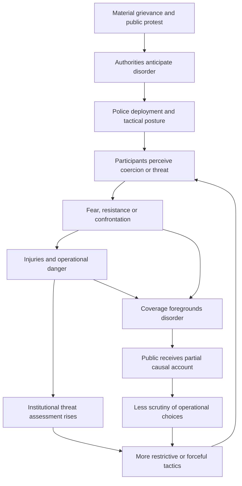
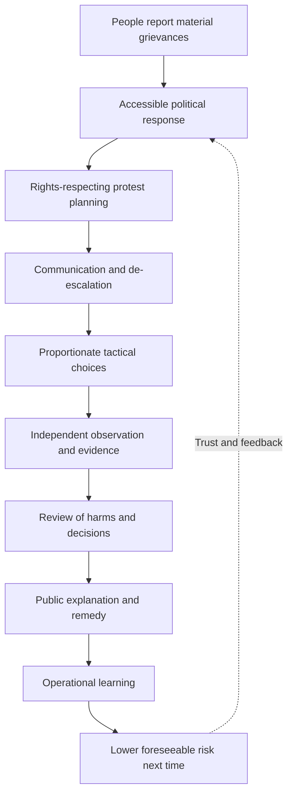

# 💨 LES GARS, VOUS AVEZ GAZÉ LE MAIRE
**First created:** 2026-10-09 | **Last updated:** 2026-10-21  
*Bally Bagayoko, the children, the police, and the Republic's remarkable talent for mistaking the management of a confrontation for an answer to the people in it.*

---

## 🛰️ Orientation

France has a mayor. France has police officers. France has prefects, ministries, municipal responsibilities, national public-order doctrine and an admirable supply of administrative desks. France also has children who would like to attend school, receive the lessons they have been promised, and grow up without discovering that their prospects have been filed under *unfortunately, the budget*.

On **6 October 2026**, **Bally Bagayoko**, the elected mayor of **Saint-Denis–Pierrefitte-sur-Seine** and a politician of **La France insoumise (LFI)**, joined a student demonstration in **Paris**. Contemporary French reporting describes and depicts him stepping between young demonstrators and police, trying to stop a confrontation. Reporting also describes him suffering the effects of tear gas. He publicly called for a change in policing instructions and for negotiations with the young people. These are no longer unidentified research leads: there are dated reports and a first-person statement. [1–5]

**The title is an authorial joke, not a transcript.** We have not established that anyone shouted *« Les gars, vous avez gazé le maire ! »* Nor does evidence of exposure establish that officers deliberately selected Bagayoko as a target. We can now distinguish the event we can document from the additional questions we cannot answer merely by enjoying the absurdity.

The larger problem is this: **an elected Black French mayor physically intervened during a confrontation involving young people demanding an education, while much of the political argument migrated towards disorder, injuries, and the supposed legitimacy of the protesters.** His intervention did not begin the story. The young people's circumstances did. Neither the law nor the press should allow them to vanish when the police enter the frame.

And, because the Republic has apparently begun assessing orchestral instruments as a public-order concern, we shall eventually have to discuss the trombone.

---

## 1. 🏛️ Bally Bagayoko Was Already Bally Bagayoko

**The mayor did not materialise out of a cloud of tear gas on 6 October.** He had been building a life in Saint-Denis, on the basketball court and in municipal politics, for decades. The footage is an episode in that history, not his introduction to public life.

Bagayoko was born on **31 July 1973 in Levallois-Perret**, in Hauts-de-Seine, and **grew up in Saint-Denis**. He played basketball to semi-professional level in departmental and regional leagues, then coached **Saint-Denis Union Sports**, reportedly helping take the club from departmental competition to France's third national division. This is more than a charming biographical detail. A coach works with young people, families, local institutions, aspirations and disappointments; a club's development takes sustained organisation. None of that automatically makes a good mayor, but it is substantive civic experience, not an ornamental photograph with a ball. [6; further biographical sourcing required]

**His political relationship with the city has also survived losing.** First elected to Saint-Denis city council in **2001**, he served as deputy mayor under Patrick Braouezec and later became vice-president of the Île-de-France Regional Council in **2008**. He joined the Left Front in **2012** and subsequently stood with La France insoumise. He spent **19 years on the municipal council** before contesting the 2020 mayoralty. That election went badly: **18.04% in the first round, third place**, and elimination. Six years later, he won the **2026 mayoral election in the first round**. A defeat did not end his relationship with the place or its people. [6; electoral figures and offices to cross-check with official records]

There is a distinction worth protecting here. **You do not have to be born and raised in the place you govern to represent it well.** People can move somewhere, listen carefully, build relationships and serve brilliantly. But it is a genuine advantage to know the neighbourhoods, institutions and young people from lived experience. Bagayoko is not simply an office-holder dispatched to manage a population he has never met. **He knows his area, and he represents his area.** His sporting work and long municipal career help explain why his presence beside students should not be treated as an inexplicable cameo.

His programme also has material content. In the 2026 campaign he proposed **gradually disarming municipal police**, beginning with ending purchases of rubber bullets. He has argued for educational investment and higher taxation of billionaires. These are contestable political choices, but they give readers an actual set of positions against which to assess his actions. When he defended standing alongside students, he reportedly said that **this is where an elected official should be**. That is a claim about the job of representation: not merely receiving briefings about young people, but showing up where they are. [2–6; programme and quotation require original-language source check]

The biography is not spotless, and it need not be made spotless. His remarks about when violence may be legitimate attracted criticism and a referral to prosecutors; he has disputed the characterisation of his words as incitement. Reporting has also scrutinised his association with Ahmed Doumbia, which Bagayoko said he regretted. Those matters deserve accurate, incident-specific treatment, not concealment and not guilt by insinuation. They do not settle what police did to students on 6 October or whether their tactics were proportionate. [6; verify allegations and responses against original reporting before republication]

After his election he was also subjected to reported racist commentary and an online misrepresentation of **« la ville des rois »** — the city of kings, referencing the basilica and its royal burials — as **« la ville des noirs »**. The dispute matters because it shows how even the vocabulary of his own city's history can become a vehicle for political distortion. The allegations, the channel's response and any prosecutorial investigations should be recorded separately rather than presented as a concluded legal finding. [6; primary recordings and procedural outcomes outstanding]

Bagayoko is a Black **French** elected official. His authority does not depend on a speculative ancestry certificate. His connection to Saint-Denis is evidenced by growing up there, coaching there, serving there, losing there and being elected there. **The Republic is looking at someone with a quarter-century of municipal political history and a longer history in the community. It might try recognising him before reaching for the gas.**

---

## 1A. 🏘️ The Manifesto Was About an Actual Place

Bagayoko's political identity is not exhausted by *LFI*, *radical left*, or the convenient photograph of a mayor in a crowd. His long involvement in Saint-Denis matters because local political programmes are made of particulars: which schools lack staff, which estates need maintenance, what housing development means for existing residents, where municipal services meet families, and how young people experience the city. His years as a basketball coach and councillor are not proof that every policy will work; they are evidence of sustained contact with the place whose problems he proposes to address.

In **Angelique Chrisafis's interview of 4 April 2026**, Bagayoko connected racist politics to austerity and inequality. He discussed the importance of investment, his opposition to racial hatred, the place of newcomers in a changing city, and changes to municipal policing. This is a particularly useful **pre-October** record: it prevents a reader from mistaking his intervention with students for a position invented after a camera arrived. [21]

A local mandate is not a universal endorsement of every mayoral decision. It is, however, a democratic fact. **If the first thing a British audience learns about the man is a label, and the last thing it learns is that he was tear-gassed, it has been denied the middle of the story.**

## 1B. 🧭 Radical, Far Left, and the Work a Label Does

The author is broadly sympathetic to Bagayoko's politics. **That is disclosed political positionality, not a finding of fact.** Other readers may reject his platform, including its proposed changes to policing. The evidence about his elected office, biography, statements and physical conduct must remain assessable independently of the author's preference.

Political science does not speak with one vocabulary. *Radical left* is a well-established designation for parties seeking significant changes to economic and political structures; *far left* is also used in specialist research, sometimes as a broad umbrella encompassing both radical and extreme-left organisations. *Extreme left* may be reserved in some typologies for positions that reject important aspects of liberal-democratic institutions. **Radical does not mean antidemocratic; nor does it mean merely using unusually dramatic tactics.** The theoretical content of a programme and the means of pursuing it both require examination. [22–24]

In February 2026 the French Interior Ministry's electoral categorisation of LFI as *extrême gauche* became a political dispute. An administrative classification, a scholarly taxonomy and a newspaper's headline are three different activities. Readers deserve to know which one is being used, and why. [25]

Saint-Denis has a long history of communist municipal leadership; **Bagayoko's immediate predecessor, Mathieu Hanotin, was Socialist**, not communist. Neither the city's longer history nor Bagayoko's LFI membership establishes that one administration is automatically to the left or right of another on every issue. **Read the programme. Meet the place. Then have the argument.**

## 1C. 🖤 He Used His Body

The defining feature of the October footage is not simply that a mayor attended a march. Reporting describes **a Black French man physically interposing himself between young people and police officers**. He was affected by tear gas; subsequent footage described by the author shows students trying to help him. The original continuous recording and the precise sequence of assistance still need archiving. [1–5]

An unfamiliar British viewer might read students helping a politician as fawning or party loyalty. That is an impoverished set of choices. A person exposed to a chemical irritant may need help irrespective of anyone's politics. Students may also recognise a local representative who has spent years in their community. And care can be reciprocal: **the adult moved towards danger; the young people moved towards him when he needed help.** Footage alone cannot assign a single motive to every participant.

The racial meaning must not be airbrushed out. Bagayoko has been the subject of reported racist abuse and dehumanising commentary. Racist narratives have long portrayed Black men as sources of danger; in this documented encounter **a Black man placed his own body in a protective position in relation to children**. That contrast is an interpretation of the image and its political context, not proof that every officer's conduct was racially motivated or that Bagayoko deliberately invited injury.

**He is not a symbol first. He is a French citizen, a mayor, a man with a history and politics of his own, making a choice about where to stand.**

---

## 2. 🕊️ Nonviolence Is Not a Protective Forcefield

In video accounts and reporting of the 6 October march, Bagayoko is described as intervening between young people and advancing police. This is a particular kind of political act: **not simply making a speech about peace, but putting a body into the space where force may be applied**. He has himself called on students to remain united and nonviolent. [2–5]

There is a long history of celebrating nonviolent resistance once the resisters are dead, safely historical, or comfortably far away. Gandhi is excellent material for a commemorative speech. Martin Luther King Jr. is excellent material for a quotation on a wall. The actual practice of nonviolent intervention is less decorative. It can involve being pushed, struck, arrested, sprayed, or otherwise harmed while attempting to prevent violence. Nonviolence is not passivity; it is not a promise that the state will be gentle in return.

This is a **comparison of political practices**, not a claim that Bagayoko has formally adopted Gandhian or Kingian doctrine. Nor can we infer that nonviolent participants have a universally higher fatality rate than violent participants: that would require a defined comparison and evidence. The narrower point is sufficient. Choosing not to retaliate does not remove the danger imposed by someone else.

**A democratic society cannot praise nonviolence only when nobody is currently practising it against that society's own institutions.**

## 3. 📍 The Sixth of October: What the Reporting Establishes

The chronology matters. **The 6 October Paris student march** is not the same event as the later **18 October Saint-Denis incident involving deputy mayor Landry Ngang**. The second event has its own witnesses, location, circumstances and accountability questions. Conflating them would reproduce precisely the documentary failure this node is meant to prevent. [1, 7, 8]

For **6 October**, contemporary RTL reporting identifies Bagayoko in the Parisian student march and reports that he was affected by tear gas. *Le Parisien* describes footage of his attempts to interpose himself during tensions and footage showing him distressed after exposure. Anadolu reports the intervention as an effort to calm tensions. Bagayoko's own published statement says he witnessed disproportionate force and asks the interior minister to review instructions before a tragedy occurs. These accounts are mutually relevant but not identical: the mayor's statement establishes what **he said**, whereas contemporaneous reporting and footage descriptions support a broader reconstruction. [1–5]

What the presently cited material **does not by itself establish** is the individual officer responsible for a specific discharge, the exact tactical order, the dispersal warnings applicable to that precise location and moment, the officer's knowledge of Bagayoko's identity, or a judicial finding on proportionality. We should not silently promote an account of exposure into a finding of deliberate targeting.

**Known:** Bagayoko was there; he intervened; contemporary outlets reported his exposure to tear gas; he demanded de-escalation. **Not determined here:** individual intent, operational legality and any eventual formal finding.

## 4. 🎥 The Camera Has a Field of View

A recording can be excellent evidence of what occurred inside its frame. It is not a magical recording of everything that happened before the first second or beyond the edge of the pavement. We need to know who filmed it, whether a longer recording exists, when the event occurred, whether the clip was edited, what officers and demonstrators were doing immediately beforehand, and whether other angles contradict or supplement it.

A witness who says *I was gassed* can accurately describe an experience without knowing who ordered the deployment. A police officer who says *we were under threat* can accurately describe an immediate perception without establishing that the preceding tactics were wise. These are not reasons to disbelieve either person. They are reasons not to ask one observation to answer every question.

The date a clip went viral is not necessarily the date it was filmed. The date of a newspaper article is not necessarily the date of the incident. In this case, the 6 October date is supported by contemporary reporting and Bagayoko's own dated publication. [1–5]

## 5. 🗣️ French First, Then Translation

Bagayoko's 6 October statement contains an appeal to the interior minister to change policing instructions urgently and a direct call for students to stay organised and nonviolent. The original is linked in the source shelf. [2]

A separate *Le Parisien* account transcribes him calling for people to stop during the confrontation; RTL likewise describes his attempts to calm the situation. The exact wording of any spoken command should be taken from a properly identified clip before it is reproduced as a transcript. [3, 5]

**Quotation protocol:** retain the original French, identify speaker and publication, then give a clearly labelled translation. Do not turn a satirical headline into somebody's actual words. The headline remains ours; the events belong to the people who lived them.

## 6. ⚖️ Four Questions the Headline Cannot Answer

| Question | What can answer it? | Current status |
|---|---|---|
| Was tear gas deployed in the encounter? | Footage, eyewitness accounts, official record | Contemporary reporting supports deployment/exposure [1, 3, 4] |
| Was Bagayoko affected? | His account, reporting, medical or other corroboration | Contemporary reporting says yes [1, 3] |
| Was the use lawful, necessary and proportionate? | Operational context, applicable law, review or finding | Not adjudicated here |
| Was he deliberately targeted as mayor? | Evidence of identification and intent | Not established |

The last two questions cannot be answered by shouting the title louder. The first two should no longer be buried in a fictional research queue. We have actual reporting.

## 7. 🏛️ The Mayor Has a Mandate, Not a Universal Remote Control

French municipal policing and national public-order operations have overlapping but distinct legal authorities. **Article L2212-1** of the *Code général des collectivités territoriales* describes the mayor's responsibility for municipal policing under the administrative supervision of the state's representative. **Article L2212-2** sets out municipal public-order objectives. **Article L211-9** of the *Code de la sécurité intérieure* regulates the dispersal of an *attroupement*, including warning procedures and specified exceptions. [9–10]

None of these provisions makes a mayor the universal commander of every national police unit in France. Equally, a mayor is not reduced to a private spectator when the safety of residents or demonstrators is at stake. **Public responsibility and operational command are not synonyms.** The companion node *Le Maire Face à la Police* explores the institutional distinction in more detail.

One important legal correction to an oversimplified account: L211-9 includes, outside Paris, a mayor or deputy among the officials who may issue relevant dispersal warnings under its specified conditions. That is **not** a general power to direct national public-order tactics; nor does it make every operation automatically lawful because a warning was given. The incident occurred in Paris, where the statute specifically treats the police prefect's role differently. [9]

## 8. 🎓 The Children Were Asking for Something

Before the riot-control equipment, there were schools. Young people were protesting shortages, inadequate conditions, unequal provision and the difficulty of imagining a secure future. Not every participant was a minor; university students and other adults joined some mobilisations. But many lycée pupils were under eighteen, and the state cannot treat that fact as a decorative detail. [6, 11]

The Education Ministry itself described missed classes, deteriorating premises, long days, anxiety about educational pathways and the feeling of not being heard. Its 6 October publication announced a national consultation and five workstreams. On 9 October it described additional replacement-teacher measures and proposed changes to student representation. Those are **announcements and commitments**, not proof that each classroom has acquired the promised teacher or that each pupil has received a remedy. [11–12]

This is the distinction developed elsewhere in *Jeunesse en Feu*: **the existence of a response is not the same as the experience of an improvement**. A ministry may have published a plan. A child may still have no physics lesson on Tuesday. Both statements can be true. The child is not required to become more grateful about the PDF.

## 9. 🎺 The Famous Terrorist Tool: The Trombone

**The orchestra was tear-gassed.** This was an incident we had already discussed in the working conversation, not an invented hypothetical to be kept in a drawer marked *research lead*. The earlier draft lost that context and then treated the gap in its own source recovery as a reason to demote the episode. That was a documentation failure, not a finding that the event had not happened.

We should nevertheless keep two evidentiary questions distinct. **Tear gas** describes the reported deployment and exposure; **CS** is a plausible agent but has not been chemically identified from the material retained in this node. Likewise, the original footage, precise location and time, deployment sequence, warnings and official explanation still need to be attached to the evidence shelf. **Those are outstanding incident particulars, not grounds for rewriting the orchestra as a hypothetical.** Nor should we automatically assume this happened during the 6 October Bagayoko encounter without a matched date and location.

The operational question is now concrete: **why was tear gas used against an orchestra?** What threat did the musicians present? Were they blocking a route, and if so, what alternatives were available? Who authorised the deployment? Were warnings audible and practicable? How did the chemical irritant affect performers, other demonstrators and bystanders? Did the intervention make anybody safer?

**The Republic has discovered the trombone. We would like to see the threat assessment.**

No, a trombone is not inherently a terrorist instrument. No, the existence of a loud brass section does not constitute a demonstrated insurgency. The joke is doing analytical work: when the state's response to music involves a chemical irritant, the burden is on the institution to explain necessity, proportionality and foreseeable consequences. We should not have to pretend the orchestra is imaginary to ask those questions.

## 9A. 🧪 Less-Lethal Is Not Less-Real

Tear gas is not a literary metaphor. **CS (2-chlorobenzalmalononitrile)** is a riot-control chemical irritant associated with acute eye, skin and respiratory effects. It is commonly described as *less-lethal* rather than harmless. The severity of exposure depends on concentration, duration, location, vulnerability, ventilation and access to care. A child, someone with respiratory disease, or someone unable to leave a contaminated space may face particular risks. The precise chemical used in the 6 October encounter should not be inferred solely from the phrase *gaz lacrymogène*. [26–27]

**Agent and delivery system are different questions.** Handheld CS spray is not the same operational intervention as an area-effect grenade, a launched canister, or a pyrotechnic crowd-control device. Projectiles and explosive devices can injure through impact, heat or blast independently of chemical exposure. A reported child hand-amputation or severe hand injury must therefore be tied to the **identified incident and identified device** before the node calls it a CS-grenade injury. The injury should not disappear merely because the munition was marketed as less-lethal. [27; incident identification outstanding]

The Chemical Weapons Convention prohibits using riot-control agents **as a method of warfare**, while allowing certain law-enforcement uses, including domestic riot control. That legal distinction does not turn a painful exposure into a trivial one. [28]

Britain's comparison requires care. **CS was used in Northern Ireland**, including in the history of British public-order operations. It is false to claim it has never been used in the United Kingdom. CS sprays have also been deployed by police in Great Britain. Claims about the historical absence of *particular grenade or area-dispersal systems* in England, Wales or Scotland need device-specific sourcing; do not substitute *mainland* for *the UK* and call the research complete. [29; delivery-system chronology to verify]

The editorial question is simple: **when British journalists report a French police operation involving children and tear gas, do they tell readers what the munition does, how it was delivered, and who was injured?**

## 10. 🚨 Police Injuries Matter. So Does Causation.

Officers were injured amid the wider October unrest, and contemporary coverage and Macron's 18 October address discussed serious violence, looting and the need to protect people. The suffering of an injured officer is not imaginary because somebody else disputes the tactics of the operation. Nor does an officer's injury prove that every prior tactical choice was justified. [13–15]

The officers exposed to danger at the front of a crowd may not have designed the operation, chosen its political objective or selected the tactical posture. They may nevertheless bear immediate physical consequences. Conversely, demonstrators who experience a threatening deployment may generalise from that experience to the next encounter. These are possible feedback mechanisms, not claims about the motives of every individual present.

**The proper question is not which side's injuries count. It is which decisions increased danger, which reduced it, and who could have changed them.**

## 11. ♻️ The Escalation Loop

This is an **analytical model of a possible reinforcing loop**, not a claim that every protest follows this sequence or that the police initiate every confrontation. Some people commit violence independently of police tactics. Some officers act with restraint and prevent injury. Some reporting is excellent. The loop matters because it can still operate without a central conspirator or universally malicious participants.

A locally rational decision can produce a systemically disastrous outcome. If an officer's immediate objective is to clear a junction, the junction may be cleared. If the operation produces panic, injuries, distrust and another confrontation tomorrow, the larger system may have failed. **A cleared street is a measurement; it is not a complete evaluation.**

## 12. ⚖️ The History Did Not Start This Tuesday

French public-order policing has a history, including colonial practices, state centralisation, discriminatory policing controversies, protest movements and successive debates over equipment and accountability. None of that proves what a named officer did on 6 October. It does establish why historical context belongs in any serious assessment of whether contemporary tactics predictably exacerbate conflict.

The dedicated node *Histoire de la Police Française* carries the historical chronology. Here the narrower question is **what institutional assumptions about crowds, authority, risk and legitimate dissent have persisted or changed**. We should distinguish direct organisational continuity, training or doctrinal transmission, and mere functional resemblance. They are not the same kind of evidence.

A government cannot reasonably insist that policing history is irrelevant whenever a new operation takes place. Equally, an historian cannot identify an individual officer's intent by pointing at the colonial archive. The useful analysis lives between those errors.

## 13. 📰 Where Does the Story Begin?

A report can begin with a police officer being injured. Another can begin with a protester being pushed. Another can begin with a line of officers advancing. Another can begin with the school whose pupils have been missing classes. All may describe something real. They do not offer the same explanation.

The authorial analogy here is to a familiar feature of **domestic-abuse rhetoric**: begin the story at the moment somebody resists coercion, and the resistance can be made to look like the origin of everything that follows. This is an analogy about **causal framing**, not an assertion that every policing encounter is domestic abuse. The comparison asks readers to notice what disappears when an account begins too late.

**An accurate report of an injury can still be an inadequate account of how the injury happened.** Reporting police injuries is essential. So is reporting what officers were ordered to do, what alternatives existed, what demonstrators did and what witnesses describe. Accountability requires sequence, not merely a tally.

## 14. 📺 Accurate Is Not the Same as Complete

A news report may truthfully say that shops were damaged, people were arrested and police used tear gas. It may still omit whether a crowd was previously peaceful, whether an order was communicated, whether a tactic was predictable to escalate tensions, or whether the original demands were answered.

That is a problem for the public, including people who support conventional policing. If nobody is allowed to discuss tactics that make officers less safe, then an institution cannot learn how to keep officers safer. If every confrontation is automatically assigned to the protesters, the public receives a broken feedback channel. The public then cannot distinguish restraint from escalation or improvement from repetition.

**Research design for a proper media comparison:** assemble a dated sample of French and British reports; record headline, opening paragraph, who is quoted, whether the students' demands appear, whether policing decisions are described, whether injuries to different groups are included, and whether subsequent findings are reported. Do not call that sampling completed until it has been done.

## 14A. 📰 The Racism You Can Quote, and the Framing You Cannot

Openly racist language is comparatively easy to identify and document. More difficult is **respectable-sounding framing** that can narrow a reader's understanding without a slur: introduce a Black elected mayor as *far left* before explaining his mandate; introduce children as *disorder* before describing their educational demands; introduce tear gas as *crowd management* without explaining the physical consequences. None of these choices alone proves discriminatory intent. Together, repeated choices may create a systematic imbalance worth measuring.

The author's hypothesis is that some **British reporting from outlets not usually regarded as strongly right-wing** has sometimes presented these protests in more ideologically delegitimising terms than comparable French coverage. **This remains a comparative hypothesis, not a completed content analysis.** We should code a defined, dated sample from both countries for headline framing, ideological labels, Bagayoko's biography, student demands, police explanations, injuries, chemical weapons, quotations from children, and whether Bagayoko himself was interviewed. Compare equivalent genres and publication dates; do not cherry-pick the most objectionable British headline and the most sympathetic French feature.

The difference between intent and effect matters. A newsroom need not intend to repeat a far-right narrative to reproduce an assumption that a racialised politician's legitimacy is conditional or that protesting children are primarily a security problem. Equally, criticism of a particular LFI policy is not itself racism. **The question is whether the audience is given enough of the person and the event to think independently of the label.**

The author's comparison with attacks and intimidation directed at Channel rescuers, including the RNLI, belongs in a separate sourced British case study. It raises a question about how media outlets condemn extremist intimidation while framing migrants, protesters or rescuers in other reporting; it does **not** establish that any particular newspaper caused any particular attack. Claims of boat damage, doxxing and threats need incident-level evidence before publication. [Further comparative research required]

And there is a practical journalistic thought: **two presenters discussing a politician is not a substitute for interviewing the politician.**

## 15. 🧿 Whose Testimony Counts?

The pupil describes a missing teacher. The ministry describes recruitment. The officer describes a threat. The mayor describes an intervention. The journalist describes a confrontation. The prefecture describes a public-order operation. Each is selecting information relevant to a different role.

The danger comes when institutional status is confused with evidentiary completeness. A ministerial statement is not necessarily false; it is also not a complete account of a child's experience. A pupil's fear is real even when the pupil cannot identify which police unit was present. A mayor's office gives Bagayoko a public platform, but it does not make his perception infallible.

His intervention raises a useful question: **did the students' treatment become more visible because an elected adult stood in the same space?** That is a researchable proposition. The node should compare actual coverage before announcing a finding.

## 16. 📰 Charlie Hebdo Has Already Introduced the Republic to Satire

The three supplied *Charlie Hebdo* covers make an excellent dated counterpoint to the idea that criticism of Macron suddenly appeared with the October demonstrations:

- **5 April 2023 — *Macron reçoit les partenaires sociaux*.** A grotesque depiction of political consultation as an absurd ceremony. The cartoon's meaning is satirical interpretation, not documentary evidence of any particular negotiation.
- **19 April 2023 — *Macron tend la main aux travailleurs*.** The offered hand is drawn as a menacing instrument; the promise of reconciliation is made physically ridiculous.
- **4 June 2025 — *Écologie, champions d'Europe !*.** A mock celebration of environmental achievement is stuffed with the controversies the cartoonists want readers to notice.

These are **primary visual sources supplied by the author**. Their dates, captions and images can be checked against the covers. They establish that French satirists were already publicly challenging Macron's claims about partnership, labour and ecological leadership years before October 2026. They do **not** establish that all French journalists defer to him; the existence of these covers is evidence that at least one important part of French media culture emphatically does not.

That distinction matters. Satire can reveal a contradiction by exaggerating it. Reporting has to investigate whether the contradiction exists in the world. Both can challenge power. Neither substitutes for the other.

## 17. 🎭 The President Is John Smith. The Press Are the Mormons.

**Macron is John Smith. The press are the Mormons.**

This is not a theological proposition, nor a literal accusation against every journalist in France. It is an authorial joke about the peculiar reverence sometimes extended to political authority even after cartoonists have spent years rendering that authority as a walking collection of neoliberal contradictions.

*Charlie Hebdo* has already introduced the Republic to the possibility that the president is not sacred. Its murdered cartoonists cannot tell us whether they would have enjoyed this particular joke. We need not appoint ourselves their posthumous spokespersons to insist that political irreverence remains a living practice.

Satire is allowed to exaggerate. Journalism has to investigate. A journalist is not required to share the author's politics. A journalist **is** required, if claiming to explain a confrontation, to do more than repeat the last dramatic thing somebody saw.

And the children are still outside asking why nobody has funded the fucking school.

Somewhere, a trombone begins playing.

**The Republic calls for reinforcements.**

## 18. 🇫🇷 Macron's Address: What Was Said, What Was Not

Macron addressed the country on **18 October 2026**, following the unrest of 17 October. Reuters reported his condemnation of destructive violence and his call for further political discussions. RTL's account describes a **ten-minute** speech, not the eight-minute duration recalled in our working conversation; the duration should be checked against the complete official recording before the finished node asserts an exact runtime. RTL also reports that he distinguished people making legitimate demands from those engaged in destruction. [13–14]

The speech therefore **was not literally devoid of references to legitimate grievances**. The sharper criticism is that acknowledging grievance in general is not the same as explaining the police response to particular children or addressing a named elected official's intervention. I have not located a complete official transcript in the sources assembled for this revision, so I will not assert that Macron *never* mentioned Bagayoko anywhere or that a single speech proves his motives.

A useful comparison asks: did the address name Bagayoko? Did it acknowledge the documented 6 October intervention? Did it discuss whether tactics contributed to escalation? Did it describe measurable educational remedies? Did it announce a process capable of changing operational practice? The public should be able to ask these questions without being accused of indifference to injured officers or damaged shops.

## 19. 🌍 The Republic Travels

France's diplomatic relationships with Francophone African states and countries in the Middle East are shaped by different histories of empire, mandate, language, trade, security and postcolonial politics. They should not be collapsed into one undifferentiated tour. Nor is diplomacy with Canada or European partners historically identical to diplomacy with former French colonies.

The author's political comparison is nonetheless legitimate: **what does it mean to articulate the Republic's democratic values abroad while young French citizens struggle to obtain a meaningful response at home?** The exact itinerary, dates and speech texts require separate sourcing before a claim about Macron's specific October travels can be treated as established. This node is not entitled to invent a flight schedule in order to improve a paragraph.

The question is particularly pointed when young French people whose families have histories tied to France's imperial and post-imperial relationships are treated in public discourse as though their political participation were an alien intrusion. They are French. Their demands are domestic democratic information, not a foreign-policy inconvenience.

## 20. 🖤 Race, Citizenship and the Right to Be Heard

The interaction of race, neighbourhood, poverty, educational opportunity and policing is not a new topic invented by this demonstration. It is a documented area of public controversy and research. But we should not use Bagayoko's identity as a substitute for examining what he actually did, or infer his private family history from the sound of his accent.

A Black mayor intervening between police and young demonstrators makes the distribution of physical and political risk visible. It asks who is expected to endure the state's coercive response and whose presence is considered sufficiently authoritative to change the story. The children should not need a mayor as a human shield to have their accounts taken seriously.

And when the mayor intervenes, he does not cease to be an elected representative because somebody dislikes LFI. Democratic representation does not operate only for politicians whose views make the executive comfortable.

## 20A. 🧠 Fanon, the Child, and the Republic's Inheritance

*Britain may enjoy a brief respite from being the principal subject of the colonial post-mortem. Today, France, we are coming for you.*

France's relationship with racialised bodies cannot be separated from its imperial history, although no single colonial history explains every contemporary encounter. **Algeria became independent in 1962**, after a war in which French forces employed torture and other forms of repression and Algerian independence movements also used armed force. The **17 October 1961** repression of Algerian demonstrators in Paris is an especially important metropolitan point of reference: colonial violence did not respect a neat boundary between the colony and the capital. [30–31]

**Frantz Fanon** was born in Martinique, not Algeria. A psychiatrist and anticolonial writer who worked in Algeria, he analysed racialisation, embodiment, the white gaze and the psychological effects of colonial violence. In *Black Skin, White Masks* (1952), the racialised man confronts a world that has already supplied meanings for his body. In *The Wretched of the Earth* (1961), Fanon examines colonial domination, resistance and the psychiatric effects of violence on colonised people and participants in repression. These are distinct texts with distinct purposes; neither should be reduced to a slogan about contemporary French police. [32–33]

**Bagayoko is not Algerian.** His family history is not a substitute for Algerian history, and he is not obliged to embody Fanon's theory. The historical question concerns institutions: which laws, doctrines, assumptions, organisational cultures or memories persist, and which do not? The existence of an ancestor who held office in colonial France would not establish a present-day official's beliefs or conduct. **Institutional transmission must be demonstrated, not inferred from surnames.**

Yet Fanon gives us language for the political significance of the encounter. A Black French mayor, who has faced racist commentary, uses **his own body** not as a threat but as an attempted barrier between children and force. **The Republic has spent centuries arguing about the Black man's body. Here is a Black man exercising his own judgement about what his body is for.** The interpretive force of that image does not depend on proving that the police consciously reenacted colonial ideology.

### 🧒 Erica Burman: the child is not only an object of protection

Erica Burman's **2016** paper, *Fanon and the child: Pedagogies of subjectification and transformation*, provides a research route into childhood, subject formation and the possibility of transformation. [34] **The paper's full argument still needs close reading; the questions below are this node's application, not quotations or conclusions attributed to Burman.**

What changes when a pupil becomes a protester? When does an institution recognise a child as capable of a political demand, and when does it redefine that same child as a public-order concern? Can an adult protect a young person without denying the young person's agency? The children here were not only the objects of Bagayoko's concern: they were organising, protesting and, in the footage described by the author, helping him afterwards.

**The Republic is having a public-order dispute with its children. The humanities would like to know whether anybody has considered listening to them.**

### ⚔️ Administrative Notice: On the Matter of Frenchness

Anyone wishing to argue that Bally Bagayoko is insufficiently French on account of being Black is hereby formally prohibited from enjoying the works of **Alexandre Dumas**.

Yes, *The Three Musketeers*.

Yes, *The Count of Monte Cristo*.

**ALL OF IT.**

Dumas's father, **General Thomas-Alexandre Dumas**, was born in Saint-Domingue to a Black enslaved mother and a white French nobleman; he rose to general in the French Revolutionary Army. Black French history is not an appendix to French history. [35]

Appeals may be submitted to the ghost of General Dumas. The Republic cannot have its musketeers and racially exclude them too.

**Bon courage.** ⚔️

## 21. 🏛️ Two Elected Officials, Two Distinct Incidents

There is a second, directly relevant incident that should **not** be merged with the first. On **18 October**, in Saint-Denis, **Landry Ngang**, deputy mayor responsible for finance and public partnerships, was reportedly pushed and sprayed by a police officer during a response to looting and disorder. *Le Parisien* reported footage and Ngang's account; *Mediapart* interviewed him. Bagayoko's own statement dated **19 October** condemned the treatment of municipal officials, acknowledged damage to shops and called for explanations from prefectural authorities. [7–8, 16]

This is not the 6 October Paris student-march encounter. It involved a different elected official, a different place, a different date and a different operational context. Its existence makes the question of relations between municipal representatives and national police more substantial, not less. But neither incident proves the legal character of the other.

A third incident is now **independently documented**, rather than a loose research lead. On **17 October 2026**, **Bernard Baudoux**, the 78-year-old mayor of **Aulnoye-Aymeries**, was assaulted by masked **Israeli settlers** near **Taybeh in the occupied West Bank**. He was accompanying European diplomats, Catholic representatives and other visitors during an olive-harvest solidarity visit with Palestinians. Reuters interviewed Baudoux, who described being violently attacked and thrown to the ground; *The Guardian* reported from the scene and published footage from immediately before and after the assault. Baudoux wore his **tricolour mayoral sash**, making his elected office visible. The delegation included French, Belgian and Polish diplomatic representatives; a Belgian diplomatic vehicle was damaged. **This was an attack on a named French mayor, not merely an attack somewhere near a diplomatic group.** [17–20]

The evidence establishes **assault and injury**, **not that Baudoux was shot**. The identified attackers were settlers; describing them as Israeli soldiers would misidentify the perpetrators. These distinctions take nothing away from the gravity of what happened. The mayor's own Reuters interview is especially useful primary testimony: he explains that he wore his sash in an attempt to protect those around him, and that this did not protect him. [18–19]

**Three elected-office encounters; three different settings:** Bagayoko intervened at the **6 October Paris student march** and was reported affected by police tear gas; deputy mayor Ngang reported being sprayed by **French police in Saint-Denis on 18 October**; Baudoux was **assaulted by Israeli settlers in occupied Palestinian territory on 17 October**. They cannot be treated as one police operation or as proof of identical institutional intent. They *can* be compared as tests of how elected authority, visible insignia, civilian safety and official accountability operate when force is used against a representative.

And here is the politically interesting question: **what response does the French Republic offer when a mayor wearing its sash is assaulted abroad, and what response does it offer when municipal representatives report force from its own police at home?** The answer requires comparing dated official statements, investigations and remedies, not merely comparing the injuries. The Republic's tricolour was present in Taybeh. It did not function as a forcefield there either.

## 22. 🪖 Colonial Methods Do Not Disappear When Empires Change Their Stationery

French colonial policing, British imperial operations in Ireland and India, the Black and Tans, and modern crowd-control practices all belong in a comparative discussion of how states conceptualise dissent and control populations. But there are three different claims we might make:

| Claim | Evidence needed |
|---|---|
| **Historical continuity** | An institution, legal rule or practice persists across time |
| **Organisational transmission** | Personnel, doctrine, training or equipment move between institutions |
| **Functional similarity** | Different institutions employ comparable methods |

The third does not prove the first two. Resemblance is a prompt for investigation, not a substitute for it.

The point of the comparison is practical. If a public-order institution adopts a posture derived from treating a population as a hostile force, it may find it harder to distinguish a democratic grievance from an adversary to be subdued. That is a possible mechanism worth tracing. It is not a licence to attribute colonial motives to every officer in a modern French street.

## 23. 🇵🇸 Palestine, Police Training and the Export of Methods

International exchanges between police and security institutions deserve scrutiny, especially where techniques developed for coercive control may travel without equivalent mechanisms for democratic accountability. Israeli policing and military responses to Palestinian demonstrations are part of that wider discussion. So are British and French imperial histories, contemporary counterinsurgency doctrine, and the political language of extremism.

This node **does not establish** that Israeli training caused any specific French tactic on 6 October. That would require identifying a training programme, participating agencies, dates, content, relevant doctrine and operational adoption. A broad claim that Western officers train with Israeli institutions is not evidence that a particular canister in Paris was deployed according to an Israeli-derived procedure.

The research question is still important: **what happens when states exchange techniques for controlling people more readily than they exchange techniques for listening to them?** The answer requires documented institutional pathways, not a rhetorical map with arrows drawn wherever an empire once existed.

## 24. 🤖 When the Student Becomes a Security Threat

The cluster's companion node on the framing of youth mobilisation as an *Islamist intifada* examines how a political demand can be reclassified through national-security language. There are genuine threats that public authorities must assess. There are also dangers in treating a heterogeneous student movement as a single extremist organisation because of isolated slogans, actors or online claims.

The Heritage Foundation's **Project Esther** is a distinct American political document; it should not be silently fused with the Henry Jackson Society or treated as proof of a French operational directive. The relevant question is how labels travel through media, politics and security institutions, and what they allow people to assume without looking again at the original facts.

A teenager demanding a teacher has not become a terrorist because somebody has found a more frightening noun for the headline. Nor does the presence of genuine violence make every participant violent. Distinguishing these propositions is basic analytical hygiene, not indulgence.

## 24A. 🧑‍✈️ Officers Are People, Not Merely Equipment

An escalation model that treats police officers as perfectly obedient mechanical outputs misses the people inside the riot gear. Officers may disagree about the proportionality of a tactic, feel distressed by confronting teenagers, or be constrained by command, peer expectations and disciplinary structures. **These are questions for evidence, not claims that a particular French unit was on the verge of refusing orders.**

Political praise for officers after unrest may reflect sincere concern about injuries and operational strain. It may also have institutional effects on morale, cohesion and the boundaries of publicly acceptable dissent. A claim that a particular speech was *designed* to prevent refusal would require documentary or testimonial evidence. The useful question is: **what channels exist for an officer to question an instruction before an avoidable injury, rather than after an inquiry?**

## 25. 🛡️ Policing by Consent Is a Design Problem

The British language of **policing by consent**, associated with the Peelian tradition, offers a useful comparison, though the familiar list of Peelian principles has a complicated later textual history and should not be quoted as if every word were written personally by Robert Peel. The underlying problem is whether a police institution can maintain legitimacy by being answerable to the public it serves.

This question is not reserved for abolitionists. People who want effective conventional policing should also want fewer avoidable injuries, better communication, defensible operational decisions, independent scrutiny and a means of changing failed tactics. A state that responds to criticism by treating every critic as a threat may win a particular confrontation while losing the information needed to police safely tomorrow.

The question is not whether officers should stand helplessly by when people are harmed. It is whether an institution can identify the difference between **protecting people** and **protecting its own immediate account of events**.

## 26. ♻️ Where the Loop Can Be Interrupted

This is a **proposed improvement pathway**, not a promise that every step causes the next. It requires real decision-makers, resources and consequences for repeated failure. A complaints office that receives complaints but never changes practice is a record-keeping system, not necessarily a learning system.

The state needs feedback from the people most affected: pupils, teachers, residents, injured officers, medics, municipal representatives and those whose livelihoods are damaged by disorder. No single group can narrate the whole system alone.

## 27. 🔎 Accountability Is a Sequence, Not a Press Release

Incident accountability asks: what happened to Bagayoko, which orders and tactics applied, what force was used, whether it was lawful, what evidence exists, and what remedy followed? The 18 October Ngang episode requires its own answers.

System accountability asks: did the operation reduce foreseeable harm? Did it protect minors? Did it prevent further injury? Were alternatives considered? Were grievances addressed? Were findings communicated to the public? Did anything change?

A prefectural explanation is not an independent investigation. An announced investigation is not a finding. A finding is not necessarily a remedy. A remedy is not necessarily institutional learning. These are separate stages, and they should be recorded separately.

**An institution can complete the paperwork and still fail the people.**

## 28. 🗂️ Evidence Ledger and Open Questions

| Item | Evidence assembled for this revision | Status / next step |
|---|---|---|
| Bagayoko's identity, local sporting history and political career | User-supplied biographical account; profile [6] | Civic chronology incorporated; cross-check club history, election results and offices against primary records |
| 6 October Paris student demonstration | RTL, *Le Parisien*, Anadolu [1, 3–5] | Established |
| His intervention between police and students | Contemporary footage descriptions and reporting [3–5] | Supported; archive original footage |
| Tear-gas exposure | Contemporary reporting [1, 3] | Supported; obtain full incident record |
| Deliberate targeting | No direct evidence assembled | **Do not allege** |
| Specific operational orders | No official incident log assembled | Outstanding |
| Student demands | Ministry documents and companion nodes [11–12] | Separate demands from implementation |
| Orchestra/trombone episode | Tear-gassing discussed in the prior working conversation; source details not carried into this draft | **Retain as reported incident**, not hypothetical; recover original footage, date, location and corroboration; CS agent not confirmed |
| Macron's 18 October speech | Reuters and RTL reporting [13–14] | Address established; official transcript and duration check outstanding |
| Bagayoko named in presidential remarks | No complete transcript assembled | Do not assert categorical silence |
| 18 October Ngang incident | *Le Parisien*, *Mediapart*, mayoral statement [7–8, 16] | Distinct documented episode |
| 17 October Taybeh assault on Bernard Baudoux | Reuters interview and video, *Guardian* eyewitness reporting, AP [17–20] | **Assault and injury documented; shooting not established** |
| *Charlie Hebdo* covers | Three user-supplied cover images | Dates and captions visible; archive original issue pages |
| Media framing across countries | Examples identified, no defined sample coded | Comparative analysis pending |
| Israeli–French tactical transmission | No programme-to-operation evidence assembled | Hypothesis, not conclusion |

For any new record, capture `event_date`, `publication_date`, `place`, `speaker`, `original_french`, `translation`, `source_type`, `url`, `firsthand_or_repost`, `corroboration`, `contradictions`, `status`, and `last_checked`. Distinguish **not searched**, **searched but not found**, **inconclusive**, and **contradicted**. These are different outcomes.

## 29. 🥖 The Paperwork Has Entered the Building

The French Republic has a president, a government, a parliament, prefects, police forces, elected mayors and a remarkable number of administrative departments.

It also has children who would like an education and a future.

Bally Bagayoko was already an elected representative before the police arrived. He was filmed intervening in a confrontation involving young people, and contemporary reporting says he was affected by tear gas. The evidence does not require us to invent an officer's motive in order to ask whether the operation made people safer. Nor does his elected status make his exposure more important than a child's. The point is that a mayor was willing to put himself where the children already were.

France has a long history of celebrating resistance once the resisting is safely historical. Contemporary resistance is considerably less convenient. The cartoonists have already drawn the contradiction. The journalists still have to investigate it.

And somewhere in all this there is still a pupil waiting for a teacher.

**LES GARS, VOUS AVEZ GAZÉ LE MAIRE.**

The headline is a joke. The mayor is real. The children are real. The questions about policing are real.

**The Republic may wish to explain why the trombone required reinforcements.**

---

## 📚 Sources and evidentiary status

**Incident-specific reporting and first-person material**

1. [RTL, 6 October 2026 — Bally Bagayoko affected by tear gas during the Paris lycée demonstration](https://www.rtl.fr/actu/politique/nous-risquons-d-avoir-un-drame-la-colere-du-maire-de-saint-denis-bally-bagayoko-touche-par-du-gaz-lacrymogene-lors-de-la-manifestation-des-lyceens-a-paris-7900681604).
2. [Bally Bagayoko, 6 October 2026 — first-person statement on student mobilisation and police force](https://www.ballybagayoko.com/jetais-aujourdhui-aux-cotes-des-lyceens-et-des-etudiants-mobilises-a-paris/). **Primary account of his position**, not independent adjudication.
3. [Le Parisien, 7 October 2026 — Bagayoko intervenes during tensions at the Paris demonstration](https://www.leparisien.fr/seine-saint-denis-93/saint-denis-93200/jeunes-cagoules-gaz-lacrymogene-bally-bagayoko-sur-le-devant-de-la-scene-lors-de-la-manifestation-lyceenne-a-paris-07-10-2026-DNIB5UTQQZFCZP4URWS7SGM2EQ.php).
4. [Anadolu, 8 October 2026 — footage of Bagayoko interposing himself between pupils and police](https://m.aa.com.tr/fr/france/france-les-images-du-maire-de-saint-denis-s-interposant-entre-lyc%C3%A9ens-et-policiers-%C3%A0-paris-deviennent-virales/4082327).
5. [RTL, 8 October 2026 — international attention to Bagayoko's intervention](https://www.rtl.fr/actu/politique/les-lyceens-pourraient-etre-mes-enfants-l-image-de-bally-bagayoko-protegeant-des-manifestants-propulse-l-elu-a-la-une-de-la-presse-mondiale-7900682666).
6. [Indian Express, October 2026 — political profile of Bagayoko and the student protests](https://indianexpress.com/article/world/the-53-year-old-in-a-suit-whos-the-face-of-frances-youth-protests-10926387/). Secondary profile; distinguish personal background reported there from inference.
7. [Le Parisien, 19 October 2026 — deputy mayor Landry Ngang reportedly sprayed by police](https://www.leparisien.fr/seine-saint-denis-93/saint-denis-un-adjoint-de-bally-bagayoko-dit-avoir-ete-gaze-gratuitement-par-un-policier-en-marge-du-pillage-dun-magasin-19-10-2026-BEY4GOUGOBFTPAG2YTNDKS4IOU.php).
8. [Mediapart, 19 October 2026 — interview with Landry Ngang](https://www.mediapart.fr/journal/politique/191026/gaze-par-un-policier-l-adjoint-au-maire-de-saint-denis-denonce-l-impunite-totale-des-forces-de-l-ordre).

**Legal and government primary sources**

9. [Légifrance — Code de la sécurité intérieure, Article L211-9](https://www.legifrance.gouv.fr/codes/article_lc/LEGIARTI000025505155).
10. [Légifrance — Code général des collectivités territoriales, Articles L2212-1 and L2212-2](https://www.legifrance.gouv.fr/codes/id/LEGISCTA000006164555).
11. [French Education Ministry, 6 October 2026 — lycée consultation and five government workstreams](https://www.education.gouv.fr/lyceennes-lyceens-vous-avez-la-parole-506143).
12. [French Education Ministry, 9 October 2026 — announced measures on teacher replacement and student representation](https://www.education.gouv.fr/construire-des-solutions-avec-les-lyceens-506143?lang=en).

**Presidential response and separate October events**

13. [Reuters, 18 October 2026 — Macron condemns violence and calls for talks](https://www.reuters.com/world/macron-condemns-shocking-scenes-violence-across-france-2026-10-18/).
14. [RTL, 18 October 2026 — summary of Macron's address](https://www.rtl.fr/actu/politique/colere-et-honte-transparence-sur-le-maintien-de-l-ordre-reponses-a-la-jeunesse-ce-qu-il-faut-retenir-de-l-allocution-d-emmanuel-macron-apres-le-17-octobre-7900686546). Secondary account; full official transcript still required for an exhaustive omission claim.
15. [Associated Press, October 2026 — policing and injuries during student protests](https://apnews.com/article/c18bbc114e2f51ef25c6851a3afa00f1).
16. [Bally Bagayoko, 19 October 2026 — statement about the treatment of Saint-Denis municipal officials](https://www.ballybagayoko.com/je-condamne-fermement-les-comportements-de-la-police-nationale-a-legard-des-elus-de-notre-ville/).
17. [Financial Times, October 2026 — settler attack on European diplomatic delegation in the West Bank](https://www.ft.com/content/35a08f82-6830-41fa-83ae-d3765f3970e0). Supplementary reporting; no shooting of the mayor established.
18. [Reuters, 17 October 2026 — Israeli settlers attack Palestinians, European diplomats and French mayor near Taybeh](https://www.reuters.com/world/middle-east/west-bank-settlers-attack-palestinians-western-diplomats-belgium-says-2026-10-17/). Includes Baudoux's first-person account.
19. [Reuters Connect, 17 October 2026 — filmed interview with Bernard Baudoux following the attack](https://www.reutersconnect.com/item/israeli-settlers-attack-palestinians-european-diplomats-in-west-bank-says-belgium/dGFnOnJldXRlcnMuY29tLDIwMjY6bmV3c21sX1ZBMTA0MDE3MTAyMDI2UlAx). Recorded first-person testimony; footage subject to Reuters licensing.
20. [The Guardian, 18 October 2026 — reporter filmed masked settlers shortly before the assault on the French mayor](https://www.theguardian.com/world/2026/oct/18/guardian-reporter-filmed-masked-militants-seconds-before-west-bank-attack-on-french-mayor). Eyewitness reporting and footage.

**Additional sources for this expansion (research and theoretical context)**

21. [The Guardian, Angelique Chrisafis, 4 April 2026 — Bagayoko on austerity, inequality and racist politics](https://www.theguardian.com/world/2026/apr/04/bally-bagayoko-austerity-politics-french-mayor-tackling-far-right). Interview predating the October demonstrations.
22. [Swiss Political Science Review — systematic review of European radical-left party research](https://onlinelibrary.wiley.com/doi/full/10.1111/spsr.12478). Terminology in specialist literature; check full text for numerical claims.
23. [Karavasilis, Custodi and Chazel — radical-left parties and national framing](https://www.research.ed.ac.uk/en/publications/how-do-radical-left-parties-frame-the-nation-a-comparison-between/). Comparative political-science framework.
24. [The PopuList — expert classification of populist, far-left and far-right parties](https://www.cambridge.org/core/journals/british-journal-of-political-science/article/populist-a-database-of-populist-farleft-and-farright-parties-using-expertinformed-qualitative-comparative-classification-eiqcc/EBF60489A0E1E3D91A6FE066C7ABA2CA). Example of *far left* used as an academic umbrella category.
25. [Le Monde, 9 February 2026 — controversy over LFI classification](https://www.lemonde.fr/en/politics/article/2026/02/09/jean-luc-melenchon-fumes-after-party-is-labeled-far-left-by-government_6750306_5.html). Reported administrative controversy.
26. [CDC — riot-control agents and health effects](https://www.cdc.gov/chemical-emergencies/chemical-fact-sheets/riot-control-agents.html). General toxicological context, not identification of the Paris agent.
27. [OPCW — riot-control agents and the Chemical Weapons Convention](https://www.opcw.org/chemical-weapons-convention). Treaty framework; delivery-system and individual injury claims require separate evidence.
28. [Chemical Weapons Convention, Article I and Article II](https://www.opcw.org/chemical-weapons-convention/articles/article-i-general-obligations). Distinction between warfare and permitted law-enforcement purposes.
29. [CAIN, Ulster University — Northern Ireland conflict archive](https://cain.ulster.ac.uk/). Research entry point for the history of riot-control agents in Northern Ireland; specific deployment records to be added.
30. [Encyclopaedia Britannica — Algerian War](https://www.britannica.com/event/Algerian-War). Historical orientation.
31. [Encyclopaedia Britannica — Paris massacre of 1961](https://www.britannica.com/event/Paris-massacre-of-1961). Historical orientation; pair with archival scholarship.
32. [Frantz Fanon, *Black Skin, White Masks* (1952)](https://en.wikipedia.org/wiki/Black_Skin,_White_Masks). Primary work; use a verified edition for page-specific quotation.
33. [Frantz Fanon, *The Wretched of the Earth* (1961)](https://en.wikipedia.org/wiki/The_Wretched_of_the_Earth). Primary work; use a verified edition for page-specific quotation.
34. [Erica Burman, *Fanon and the child: Pedagogies of subjectification and transformation*, *Curriculum Inquiry* 46(3), 2016](https://doi.org/10.1080/03626784.2016.1168263). Full-text close reading outstanding.
35. [Encyclopaedia Britannica — Alexandre Dumas](https://www.britannica.com/biography/Alexandre-Dumas-pere). Literary and family-history context.

**Visual primary material:** three *Charlie Hebdo* covers supplied by the author: **5 April 2023**, **19 April 2023**, **4 June 2025**. They support analysis of published satire, not factual conclusions about Macron's motives or all French journalism. The original issue pages have not been independently retrieved for this revision.

**Analytical status:** The Mermaid diagrams, domestic-abuse rhetoric comparison, John Smith/*Book of Mormon* joke, colonial-transmission hypotheses and proposed interventions are **authorial analysis**, not incident-specific evidence. No phantom planning files or purported internal research audits are cited as authority.

## 🔎 Outstanding verification

The expansion adds priorities: the full Burman article and precise Fanon editions; official 2026 municipal results; Bagayoko manifesto; a coded and reproducible French/British press sample; documentation of any child hand injury and exact munition; UK/NI CS delivery-system history; and a source-specific check of the April Guardian interview. The additional sources are reading leads and cited contextual materials, not a claim that every linked full text has been independently reviewed in this revision.

The priority acquisitions are the original full-length 6 October footage; prefectural or police operational statements; any formal complaint or oversight findings; the full official text and recording of Macron's 18 October address; the original orchestra incident footage and its date, location, witness accounts and police response (without treating the incident as hypothetical); and a defined French/British media sample. The West Bank mayor is now identified as Bernard Baudoux, and his assault is corroborated by contemporary interviews and eyewitness reporting; any specific claim that he was shot remains unsupported. A comparison of official French responses across the three incidents remains to be assembled. International police-training claims require programme-level documentation before being attached to a specific French deployment.

---

## 🌌 Constellations

- [🏛️ Le Maire Face à la Police](./🏛️_le_maire_face_a_la_police.md) — elected municipal authority and national command.
- [⚖️ Histoire de la Police Française](./⚖️_histoire_de_la_police_francaise.md) — institutional history and colonial legacies.
- [🚨 La Police Face à la Jeunesse](./🚨_la_police_face_a_la_jeunesse.md) — protest policing, force and accountability.
- [🎓 Ce Que Réclame la Jeunesse](./🎓_ce_que_reclame_la_jeunesse.md) — what the students demand.
- [🏫 L'École et les Inégalités](./🏫_lecole_et_les_inegalites.md) — unequal provision and educational futures.
- [💰 Des Livres, Pas des Bombes](./💰_des_livres_pas_des_bombes.md) — budgets and experienced provision.
- [🎬 La Haine n'a Jamais Disparu](./🎬_la_haine_na_jamais_disparu.md) — political and cultural memory.
- [🤖 When Did It Become an Islamist Intifada?](./🤖_when_did_it_become_an_islamist_intifada.md) — securitisation and racialised media frames.
- [📣 Les Mots de la Colère](./📣_les_mots_de_la_colere.md) — students' language.
- [⏱️ Chronologie de la Révolte](./⏱️_chronologie_de_la_revolte.md) — dated evidence spine.

## ✨ Stardust

Bally Bagayoko, Frantz Fanon, Black Skin White Masks, Wretched of the Earth, Erica Burman, subjectification, Alexandre Dumas, Thomas-Alexandre Dumas, Algerian War, 17 October 1961, radical left, far left, comparative media framing, CS gas, Chemical Weapons Convention, reciprocal care, Black French citizenship, Saint-Denis Union Sports, basketball coaching, 2001 city council, 2020 mayoral defeat, 2026 first-round victory, municipal representation, Bernard Baudoux, Aulnoye-Aymeries, Taybeh, West Bank, settler assault, Saint-Denis, Pierrefitte-sur-Seine, 6 October 2026, Landry Ngang, 18 October 2026, French lycée protests, nonviolent intervention, tear gas, police accountability, escalation loops, crowd control, children, educational inequality, media causality, Charlie Hebdo, Macron, John Smith, Book of Mormon, trombone, orchestra tear-gassing, chemical irritants, CS identification unresolved, policing by consent, colonial policing, France, Palestine, Embodied Information Ecology, survivor voice, Polaris Protocol.

## 🏮 Footer

*LES GARS, VOUS AVEZ GAZÉ LE MAIRE* is a living analytical node of the **Polaris Protocol**. It combines incident-specific reporting, legal context, survivor-authored political argument, historically situated interpretation, and explicitly labelled cybernetic models. It does not substitute political interpretation for findings about individual conduct.

[🏮 Return to Jeunesse en Feu](./README.md)

*Survivor authorship is sovereign. Containment is never neutral.*

_Last updated: 2026-10-21_
