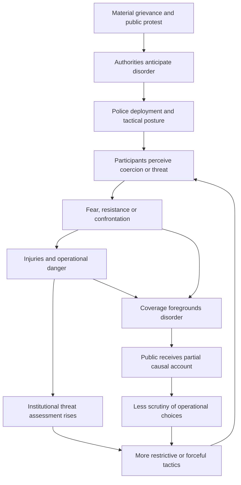
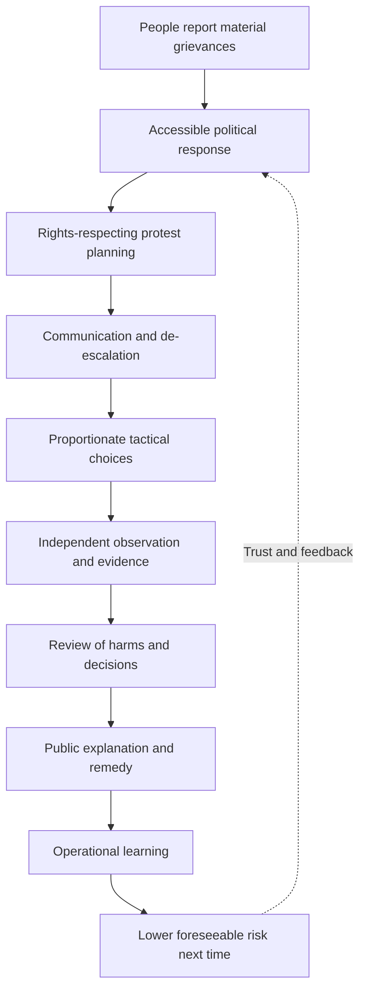

# 💨 LES GARS, VOUS AVEZ GAZÉ LE MAIRE
**First created:** 2026-10-09 | **Last updated:** 2026-10-21  
*Bally Bagayoko, the children, the police, and the Republic's remarkable talent for mistaking the management of a confrontation for an answer to the people in it.*

---

## 🛰️ Orientation

France has a mayor. France has police officers. France has prefects, ministries, municipal responsibilities, national public-order doctrine and an admirable supply of administrative desks. France also has children who would like to attend school, receive the lessons they have been promised, and grow up without discovering that their prospects have been filed under *unfortunately, the budget*.

On **6 October 2026**, **Bally Bagayoko**, the elected mayor of **Saint-Denis–Pierrefitte-sur-Seine** and a politician of **La France insoumise (LFI)**, joined a student demonstration in **Paris**. Contemporary French reporting describes and depicts him stepping between young demonstrators and police, trying to stop a confrontation. Reporting also describes him suffering the effects of tear gas. He publicly called for a change in policing instructions and for negotiations with the young people. These are no longer unidentified research leads: there are dated reports and a first-person statement. [1–5]

**The title is an authorial joke, not a transcript.** We have not established that anyone shouted *« Les gars, vous avez gazé le maire ! »* Nor does evidence of exposure establish that officers deliberately selected Bagayoko as a target. We can now distinguish the event we can document from the additional questions we cannot answer merely by enjoying the absurdity.

The larger problem is this: **an elected Black French mayor physically intervened during a confrontation involving young people demanding an education, while much of the political argument migrated towards disorder, injuries, and the supposed legitimacy of the protesters.** His intervention did not begin the story. The young people's circumstances did. Neither the law nor the press should allow them to vanish when the police enter the frame.

And, because the Republic has apparently begun assessing orchestral instruments as a public-order concern, we shall eventually have to discuss the trombone.

---

## 1. 🏛️ Bally Bagayoko Was Already Bally Bagayoko

The mayor did not become a political actor at the moment a camera found him. Bagayoko's affiliation with LFI, his leadership of Saint-Denis–Pierrefitte-sur-Seine, and his public advocacy for young people and poorer neighbourhoods are part of the context. In an interview reported internationally, he defended his participation as an obligation towards young people whose experiences and demands he recognised. The significance is not that a mayor happened to be nearby; it is that an elected representative chose to enter a situation of physical risk rather than comment upon it from a safe distance. [3, 4, 6]

That decision is not immune from political criticism. His comments about the legitimacy of some forms of resistance have generated controversy, and political opponents may disagree strongly with his rhetoric or his party. Those disputes should be described in their own terms. They do not settle what officers did on 6 October, whether a particular use of force was necessary, or whether students were entitled to be heard. A person's political affiliation is not a substitute for an incident reconstruction.

Bagayoko is a Black **French** elected official. That is relevant to questions of representation and the history of French policing. It does not require a speculative account of his parents, his accent, his nationality, or the number of generations his family has lived in France. His authority derives from his elected office; his conduct can be assessed on its own evidence. The Republic is not entitled to ask for an ancestry certificate before recognising one of its mayors.

## 2. 🕊️ Nonviolence Is Not a Protective Forcefield

In video accounts and reporting of the 6 October march, Bagayoko is described as intervening between young people and advancing police. This is a particular kind of political act: **not simply making a speech about peace, but putting a body into the space where force may be applied**. He has himself called on students to remain united and nonviolent. [2–5]

There is a long history of celebrating nonviolent resistance once the resisters are dead, safely historical, or comfortably far away. Gandhi is excellent material for a commemorative speech. Martin Luther King Jr. is excellent material for a quotation on a wall. The actual practice of nonviolent intervention is less decorative. It can involve being pushed, struck, arrested, sprayed, or otherwise harmed while attempting to prevent violence. Nonviolence is not passivity; it is not a promise that the state will be gentle in return.

This is a **comparison of political practices**, not a claim that Bagayoko has formally adopted Gandhian or Kingian doctrine. Nor can we infer that nonviolent participants have a universally higher fatality rate than violent participants: that would require a defined comparison and evidence. The narrower point is sufficient. Choosing not to retaliate does not remove the danger imposed by someone else.

**A democratic society cannot praise nonviolence only when nobody is currently practising it against that society's own institutions.**

## 3. 📍 The Sixth of October: What the Reporting Establishes

The chronology matters. **The 6 October Paris student march** is not the same event as the later **18 October Saint-Denis incident involving deputy mayor Landry Ngang**. The second event has its own witnesses, location, circumstances and accountability questions. Conflating them would reproduce precisely the documentary failure this node is meant to prevent. [1, 7, 8]

For **6 October**, contemporary RTL reporting identifies Bagayoko in the Parisian student march and reports that he was affected by tear gas. *Le Parisien* describes footage of his attempts to interpose himself during tensions and footage showing him distressed after exposure. Anadolu reports the intervention as an effort to calm tensions. Bagayoko's own published statement says he witnessed disproportionate force and asks the interior minister to review instructions before a tragedy occurs. These accounts are mutually relevant but not identical: the mayor's statement establishes what **he said**, whereas contemporaneous reporting and footage descriptions support a broader reconstruction. [1–5]

What the presently cited material **does not by itself establish** is the individual officer responsible for a specific discharge, the exact tactical order, the dispersal warnings applicable to that precise location and moment, the officer's knowledge of Bagayoko's identity, or a judicial finding on proportionality. We should not silently promote an account of exposure into a finding of deliberate targeting.

**Known:** Bagayoko was there; he intervened; contemporary outlets reported his exposure to tear gas; he demanded de-escalation. **Not determined here:** individual intent, operational legality and any eventual formal finding.

## 4. 🎥 The Camera Has a Field of View

A recording can be excellent evidence of what occurred inside its frame. It is not a magical recording of everything that happened before the first second or beyond the edge of the pavement. We need to know who filmed it, whether a longer recording exists, when the event occurred, whether the clip was edited, what officers and demonstrators were doing immediately beforehand, and whether other angles contradict or supplement it.

A witness who says *I was gassed* can accurately describe an experience without knowing who ordered the deployment. A police officer who says *we were under threat* can accurately describe an immediate perception without establishing that the preceding tactics were wise. These are not reasons to disbelieve either person. They are reasons not to ask one observation to answer every question.

The date a clip went viral is not necessarily the date it was filmed. The date of a newspaper article is not necessarily the date of the incident. In this case, the 6 October date is supported by contemporary reporting and Bagayoko's own dated publication. [1–5]

## 5. 🗣️ French First, Then Translation

Bagayoko's 6 October statement contains an appeal to the interior minister to change policing instructions urgently and a direct call for students to stay organised and nonviolent. The original is linked in the source shelf. [2]

A separate *Le Parisien* account transcribes him calling for people to stop during the confrontation; RTL likewise describes his attempts to calm the situation. The exact wording of any spoken command should be taken from a properly identified clip before it is reproduced as a transcript. [3, 5]

**Quotation protocol:** retain the original French, identify speaker and publication, then give a clearly labelled translation. Do not turn a satirical headline into somebody's actual words. The headline remains ours; the events belong to the people who lived them.

## 6. ⚖️ Four Questions the Headline Cannot Answer

| Question | What can answer it? | Current status |
|---|---|---|
| Was tear gas deployed in the encounter? | Footage, eyewitness accounts, official record | Contemporary reporting supports deployment/exposure [1, 3, 4] |
| Was Bagayoko affected? | His account, reporting, medical or other corroboration | Contemporary reporting says yes [1, 3] |
| Was the use lawful, necessary and proportionate? | Operational context, applicable law, review or finding | Not adjudicated here |
| Was he deliberately targeted as mayor? | Evidence of identification and intent | Not established |

The last two questions cannot be answered by shouting the title louder. The first two should no longer be buried in a fictional research queue. We have actual reporting.

## 7. 🏛️ The Mayor Has a Mandate, Not a Universal Remote Control

French municipal policing and national public-order operations have overlapping but distinct legal authorities. **Article L2212-1** of the *Code général des collectivités territoriales* describes the mayor's responsibility for municipal policing under the administrative supervision of the state's representative. **Article L2212-2** sets out municipal public-order objectives. **Article L211-9** of the *Code de la sécurité intérieure* regulates the dispersal of an *attroupement*, including warning procedures and specified exceptions. [9–10]

None of these provisions makes a mayor the universal commander of every national police unit in France. Equally, a mayor is not reduced to a private spectator when the safety of residents or demonstrators is at stake. **Public responsibility and operational command are not synonyms.** The companion node *Le Maire Face à la Police* explores the institutional distinction in more detail.

One important legal correction to an oversimplified account: L211-9 includes, outside Paris, a mayor or deputy among the officials who may issue relevant dispersal warnings under its specified conditions. That is **not** a general power to direct national public-order tactics; nor does it make every operation automatically lawful because a warning was given. The incident occurred in Paris, where the statute specifically treats the police prefect's role differently. [9]

## 8. 🎓 The Children Were Asking for Something

Before the riot-control equipment, there were schools. Young people were protesting shortages, inadequate conditions, unequal provision and the difficulty of imagining a secure future. Not every participant was a minor; university students and other adults joined some mobilisations. But many lycée pupils were under eighteen, and the state cannot treat that fact as a decorative detail. [6, 11]

The Education Ministry itself described missed classes, deteriorating premises, long days, anxiety about educational pathways and the feeling of not being heard. Its 6 October publication announced a national consultation and five workstreams. On 9 October it described additional replacement-teacher measures and proposed changes to student representation. Those are **announcements and commitments**, not proof that each classroom has acquired the promised teacher or that each pupil has received a remedy. [11–12]

This is the distinction developed elsewhere in *Jeunesse en Feu*: **the existence of a response is not the same as the experience of an improvement**. A ministry may have published a plan. A child may still have no physics lesson on Tuesday. Both statements can be true. The child is not required to become more grateful about the PDF.

## 9. 🎺 The Famous Terrorist Tool: The Trombone

The cluster contains a reported episode involving student musicians and the use of tear gas. **This node does not yet have an independently authenticated original recording and incident reconstruction for that specific episode.** It should therefore remain a clearly labelled research lead rather than be smuggled into the verified 6 October timeline.

But the operational questions are real, and the hypothetical is instructive. If an orchestra is obstructing a route, that may create a public-order problem. It does not by itself establish that chemical irritants are necessary, proportionate or the least harmful available option. What was the actual threat? Who assessed it? Were there warnings? Could officers communicate, redirect, wait or use a less intrusive response? What did the intervention predictably do to the crowd?

**The Republic has discovered the trombone. We would like to see the threat assessment.**

No, a trombone is not inherently a terrorist instrument. No, the existence of a loud brass section does not constitute a demonstrated insurgency. And yes, the point is serious: public-order tactics should be judged by what they prevent and what they cause, not merely by the fact that somebody possessed the authority to deploy them.

## 10. 🚨 Police Injuries Matter. So Does Causation.

Officers were injured amid the wider October unrest, and contemporary coverage and Macron's 18 October address discussed serious violence, looting and the need to protect people. The suffering of an injured officer is not imaginary because somebody else disputes the tactics of the operation. Nor does an officer's injury prove that every prior tactical choice was justified. [13–15]

The officers exposed to danger at the front of a crowd may not have designed the operation, chosen its political objective or selected the tactical posture. They may nevertheless bear immediate physical consequences. Conversely, demonstrators who experience a threatening deployment may generalise from that experience to the next encounter. These are possible feedback mechanisms, not claims about the motives of every individual present.

**The proper question is not which side's injuries count. It is which decisions increased danger, which reduced it, and who could have changed them.**

## 11. ♻️ The Escalation Loop

This is an **analytical model of a possible reinforcing loop**, not a claim that every protest follows this sequence or that the police initiate every confrontation. Some people commit violence independently of police tactics. Some officers act with restraint and prevent injury. Some reporting is excellent. The loop matters because it can still operate without a central conspirator or universally malicious participants.

A locally rational decision can produce a systemically disastrous outcome. If an officer's immediate objective is to clear a junction, the junction may be cleared. If the operation produces panic, injuries, distrust and another confrontation tomorrow, the larger system may have failed. **A cleared street is a measurement; it is not a complete evaluation.**

## 12. ⚖️ The History Did Not Start This Tuesday

French public-order policing has a history, including colonial practices, state centralisation, discriminatory policing controversies, protest movements and successive debates over equipment and accountability. None of that proves what a named officer did on 6 October. It does establish why historical context belongs in any serious assessment of whether contemporary tactics predictably exacerbate conflict.

The dedicated node *Histoire de la Police Française* carries the historical chronology. Here the narrower question is **what institutional assumptions about crowds, authority, risk and legitimate dissent have persisted or changed**. We should distinguish direct organisational continuity, training or doctrinal transmission, and mere functional resemblance. They are not the same kind of evidence.

A government cannot reasonably insist that policing history is irrelevant whenever a new operation takes place. Equally, an historian cannot identify an individual officer's intent by pointing at the colonial archive. The useful analysis lives between those errors.

## 13. 📰 Where Does the Story Begin?

A report can begin with a police officer being injured. Another can begin with a protester being pushed. Another can begin with a line of officers advancing. Another can begin with the school whose pupils have been missing classes. All may describe something real. They do not offer the same explanation.

The authorial analogy here is to a familiar feature of **domestic-abuse rhetoric**: begin the story at the moment somebody resists coercion, and the resistance can be made to look like the origin of everything that follows. This is an analogy about **causal framing**, not an assertion that every policing encounter is domestic abuse. The comparison asks readers to notice what disappears when an account begins too late.

**An accurate report of an injury can still be an inadequate account of how the injury happened.** Reporting police injuries is essential. So is reporting what officers were ordered to do, what alternatives existed, what demonstrators did and what witnesses describe. Accountability requires sequence, not merely a tally.

## 14. 📺 Accurate Is Not the Same as Complete

A news report may truthfully say that shops were damaged, people were arrested and police used tear gas. It may still omit whether a crowd was previously peaceful, whether an order was communicated, whether a tactic was predictable to escalate tensions, or whether the original demands were answered.

That is a problem for the public, including people who support conventional policing. If nobody is allowed to discuss tactics that make officers less safe, then an institution cannot learn how to keep officers safer. If every confrontation is automatically assigned to the protesters, the public receives a broken feedback channel. The public then cannot distinguish restraint from escalation or improvement from repetition.

**Research design for a proper media comparison:** assemble a dated sample of French and British reports; record headline, opening paragraph, who is quoted, whether the students' demands appear, whether policing decisions are described, whether injuries to different groups are included, and whether subsequent findings are reported. Do not call that sampling completed until it has been done.

## 15. 🧿 Whose Testimony Counts?

The pupil describes a missing teacher. The ministry describes recruitment. The officer describes a threat. The mayor describes an intervention. The journalist describes a confrontation. The prefecture describes a public-order operation. Each is selecting information relevant to a different role.

The danger comes when institutional status is confused with evidentiary completeness. A ministerial statement is not necessarily false; it is also not a complete account of a child's experience. A pupil's fear is real even when the pupil cannot identify which police unit was present. A mayor's office gives Bagayoko a public platform, but it does not make his perception infallible.

His intervention raises a useful question: **did the students' treatment become more visible because an elected adult stood in the same space?** That is a researchable proposition. The node should compare actual coverage before announcing a finding.

## 16. 📰 Charlie Hebdo Has Already Introduced the Republic to Satire

The three supplied *Charlie Hebdo* covers make an excellent dated counterpoint to the idea that criticism of Macron suddenly appeared with the October demonstrations:

- **5 April 2023 — *Macron reçoit les partenaires sociaux*.** A grotesque depiction of political consultation as an absurd ceremony. The cartoon's meaning is satirical interpretation, not documentary evidence of any particular negotiation.
- **19 April 2023 — *Macron tend la main aux travailleurs*.** The offered hand is drawn as a menacing instrument; the promise of reconciliation is made physically ridiculous.
- **4 June 2025 — *Écologie, champions d'Europe !*.** A mock celebration of environmental achievement is stuffed with the controversies the cartoonists want readers to notice.

These are **primary visual sources supplied by the author**. Their dates, captions and images can be checked against the covers. They establish that French satirists were already publicly challenging Macron's claims about partnership, labour and ecological leadership years before October 2026. They do **not** establish that all French journalists defer to him; the existence of these covers is evidence that at least one important part of French media culture emphatically does not.

That distinction matters. Satire can reveal a contradiction by exaggerating it. Reporting has to investigate whether the contradiction exists in the world. Both can challenge power. Neither substitutes for the other.

## 17. 🎭 The President Is John Smith. The Press Are the Mormons.

**Macron is John Smith. The press are the Mormons.**

This is not a theological proposition, nor a literal accusation against every journalist in France. It is an authorial joke about the peculiar reverence sometimes extended to political authority even after cartoonists have spent years rendering that authority as a walking collection of neoliberal contradictions.

*Charlie Hebdo* has already introduced the Republic to the possibility that the president is not sacred. Its murdered cartoonists cannot tell us whether they would have enjoyed this particular joke. We need not appoint ourselves their posthumous spokespersons to insist that political irreverence remains a living practice.

Satire is allowed to exaggerate. Journalism has to investigate. A journalist is not required to share the author's politics. A journalist **is** required, if claiming to explain a confrontation, to do more than repeat the last dramatic thing somebody saw.

And the children are still outside asking why nobody has funded the fucking school.

Somewhere, a trombone begins playing.

**The Republic calls for reinforcements.**

## 18. 🇫🇷 Macron's Address: What Was Said, What Was Not

Macron addressed the country on **18 October 2026**, following the unrest of 17 October. Reuters reported his condemnation of destructive violence and his call for further political discussions. RTL's account describes a **ten-minute** speech, not the eight-minute duration recalled in our working conversation; the duration should be checked against the complete official recording before the finished node asserts an exact runtime. RTL also reports that he distinguished people making legitimate demands from those engaged in destruction. [13–14]

The speech therefore **was not literally devoid of references to legitimate grievances**. The sharper criticism is that acknowledging grievance in general is not the same as explaining the police response to particular children or addressing a named elected official's intervention. I have not located a complete official transcript in the sources assembled for this revision, so I will not assert that Macron *never* mentioned Bagayoko anywhere or that a single speech proves his motives.

A useful comparison asks: did the address name Bagayoko? Did it acknowledge the documented 6 October intervention? Did it discuss whether tactics contributed to escalation? Did it describe measurable educational remedies? Did it announce a process capable of changing operational practice? The public should be able to ask these questions without being accused of indifference to injured officers or damaged shops.

## 19. 🌍 The Republic Travels

France's diplomatic relationships with Francophone African states and countries in the Middle East are shaped by different histories of empire, mandate, language, trade, security and postcolonial politics. They should not be collapsed into one undifferentiated tour. Nor is diplomacy with Canada or European partners historically identical to diplomacy with former French colonies.

The author's political comparison is nonetheless legitimate: **what does it mean to articulate the Republic's democratic values abroad while young French citizens struggle to obtain a meaningful response at home?** The exact itinerary, dates and speech texts require separate sourcing before a claim about Macron's specific October travels can be treated as established. This node is not entitled to invent a flight schedule in order to improve a paragraph.

The question is particularly pointed when young French people whose families have histories tied to France's imperial and post-imperial relationships are treated in public discourse as though their political participation were an alien intrusion. They are French. Their demands are domestic democratic information, not a foreign-policy inconvenience.

## 20. 🖤 Race, Citizenship and the Right to Be Heard

The interaction of race, neighbourhood, poverty, educational opportunity and policing is not a new topic invented by this demonstration. It is a documented area of public controversy and research. But we should not use Bagayoko's identity as a substitute for examining what he actually did, or infer his private family history from the sound of his accent.

A Black mayor intervening between police and young demonstrators makes the distribution of physical and political risk visible. It asks who is expected to endure the state's coercive response and whose presence is considered sufficiently authoritative to change the story. The children should not need a mayor as a human shield to have their accounts taken seriously.

And when the mayor intervenes, he does not cease to be an elected representative because somebody dislikes LFI. Democratic representation does not operate only for politicians whose views make the executive comfortable.

## 21. 🏛️ Two Elected Officials, Two Distinct Incidents

There is a second, directly relevant incident that should **not** be merged with the first. On **18 October**, in Saint-Denis, **Landry Ngang**, deputy mayor responsible for finance and public partnerships, was reportedly pushed and sprayed by a police officer during a response to looting and disorder. *Le Parisien* reported footage and Ngang's account; *Mediapart* interviewed him. Bagayoko's own statement dated **19 October** condemned the treatment of municipal officials, acknowledged damage to shops and called for explanations from prefectural authorities. [7–8, 16]

This is not the 6 October Paris student-march encounter. It involved a different elected official, a different place, a different date and a different operational context. Its existence makes the question of relations between municipal representatives and national police more substantial, not less. But neither incident proves the legal character of the other.

A separate reported **17 October West Bank incident** involving European diplomats and an injured French mayor is also a research lead for comparison. Available reporting describes an attack by Israeli settlers on a visiting diplomatic group; it does not, on the material used here, establish the specific claim that a French mayor was **shot**. We should therefore not say that he was shot, or substitute soldiers for settlers, without stronger incident-specific evidence. [17]

The comparison is about how France responds when elected officials face force in different jurisdictions. It must not be built by blending three different episodes into one cinematic sequence.

## 22. 🪖 Colonial Methods Do Not Disappear When Empires Change Their Stationery

French colonial policing, British imperial operations in Ireland and India, the Black and Tans, and modern crowd-control practices all belong in a comparative discussion of how states conceptualise dissent and control populations. But there are three different claims we might make:

| Claim | Evidence needed |
|---|---|
| **Historical continuity** | An institution, legal rule or practice persists across time |
| **Organisational transmission** | Personnel, doctrine, training or equipment move between institutions |
| **Functional similarity** | Different institutions employ comparable methods |

The third does not prove the first two. Resemblance is a prompt for investigation, not a substitute for it.

The point of the comparison is practical. If a public-order institution adopts a posture derived from treating a population as a hostile force, it may find it harder to distinguish a democratic grievance from an adversary to be subdued. That is a possible mechanism worth tracing. It is not a licence to attribute colonial motives to every officer in a modern French street.

## 23. 🇵🇸 Palestine, Police Training and the Export of Methods

International exchanges between police and security institutions deserve scrutiny, especially where techniques developed for coercive control may travel without equivalent mechanisms for democratic accountability. Israeli policing and military responses to Palestinian demonstrations are part of that wider discussion. So are British and French imperial histories, contemporary counterinsurgency doctrine, and the political language of extremism.

This node **does not establish** that Israeli training caused any specific French tactic on 6 October. That would require identifying a training programme, participating agencies, dates, content, relevant doctrine and operational adoption. A broad claim that Western officers train with Israeli institutions is not evidence that a particular canister in Paris was deployed according to an Israeli-derived procedure.

The research question is still important: **what happens when states exchange techniques for controlling people more readily than they exchange techniques for listening to them?** The answer requires documented institutional pathways, not a rhetorical map with arrows drawn wherever an empire once existed.

## 24. 🤖 When the Student Becomes a Security Threat

The cluster's companion node on the framing of youth mobilisation as an *Islamist intifada* examines how a political demand can be reclassified through national-security language. There are genuine threats that public authorities must assess. There are also dangers in treating a heterogeneous student movement as a single extremist organisation because of isolated slogans, actors or online claims.

The Heritage Foundation's **Project Esther** is a distinct American political document; it should not be silently fused with the Henry Jackson Society or treated as proof of a French operational directive. The relevant question is how labels travel through media, politics and security institutions, and what they allow people to assume without looking again at the original facts.

A teenager demanding a teacher has not become a terrorist because somebody has found a more frightening noun for the headline. Nor does the presence of genuine violence make every participant violent. Distinguishing these propositions is basic analytical hygiene, not indulgence.

## 25. 🛡️ Policing by Consent Is a Design Problem

The British language of **policing by consent**, associated with the Peelian tradition, offers a useful comparison, though the familiar list of Peelian principles has a complicated later textual history and should not be quoted as if every word were written personally by Robert Peel. The underlying problem is whether a police institution can maintain legitimacy by being answerable to the public it serves.

This question is not reserved for abolitionists. People who want effective conventional policing should also want fewer avoidable injuries, better communication, defensible operational decisions, independent scrutiny and a means of changing failed tactics. A state that responds to criticism by treating every critic as a threat may win a particular confrontation while losing the information needed to police safely tomorrow.

The question is not whether officers should stand helplessly by when people are harmed. It is whether an institution can identify the difference between **protecting people** and **protecting its own immediate account of events**.

## 26. ♻️ Where the Loop Can Be Interrupted

This is a **proposed improvement pathway**, not a promise that every step causes the next. It requires real decision-makers, resources and consequences for repeated failure. A complaints office that receives complaints but never changes practice is a record-keeping system, not necessarily a learning system.

The state needs feedback from the people most affected: pupils, teachers, residents, injured officers, medics, municipal representatives and those whose livelihoods are damaged by disorder. No single group can narrate the whole system alone.

## 27. 🔎 Accountability Is a Sequence, Not a Press Release

Incident accountability asks: what happened to Bagayoko, which orders and tactics applied, what force was used, whether it was lawful, what evidence exists, and what remedy followed? The 18 October Ngang episode requires its own answers.

System accountability asks: did the operation reduce foreseeable harm? Did it protect minors? Did it prevent further injury? Were alternatives considered? Were grievances addressed? Were findings communicated to the public? Did anything change?

A prefectural explanation is not an independent investigation. An announced investigation is not a finding. A finding is not necessarily a remedy. A remedy is not necessarily institutional learning. These are separate stages, and they should be recorded separately.

**An institution can complete the paperwork and still fail the people.**

## 28. 🗂️ Evidence Ledger and Open Questions

| Item | Evidence assembled for this revision | Status / next step |
|---|---|---|
| Bagayoko's identity and office | Contemporary reporting and own statement [1–6] | Established |
| 6 October Paris student demonstration | RTL, *Le Parisien*, Anadolu [1, 3–5] | Established |
| His intervention between police and students | Contemporary footage descriptions and reporting [3–5] | Supported; archive original footage |
| Tear-gas exposure | Contemporary reporting [1, 3] | Supported; obtain full incident record |
| Deliberate targeting | No direct evidence assembled | **Do not allege** |
| Specific operational orders | No official incident log assembled | Outstanding |
| Student demands | Ministry documents and companion nodes [11–12] | Separate demands from implementation |
| Orchestra/trombone episode | Lead from cluster discussion | Original footage and corroboration outstanding |
| Macron's 18 October speech | Reuters and RTL reporting [13–14] | Address established; official transcript and duration check outstanding |
| Bagayoko named in presidential remarks | No complete transcript assembled | Do not assert categorical silence |
| 18 October Ngang incident | *Le Parisien*, *Mediapart*, mayoral statement [7–8, 16] | Distinct documented episode |
| West Bank mayor report | Financial Times account [17] | Injury reported; **shooting not established** |
| *Charlie Hebdo* covers | Three user-supplied cover images | Dates and captions visible; archive original issue pages |
| Media framing across countries | Examples identified, no defined sample coded | Comparative analysis pending |
| Israeli–French tactical transmission | No programme-to-operation evidence assembled | Hypothesis, not conclusion |

For any new record, capture `event_date`, `publication_date`, `place`, `speaker`, `original_french`, `translation`, `source_type`, `url`, `firsthand_or_repost`, `corroboration`, `contradictions`, `status`, and `last_checked`. Distinguish **not searched**, **searched but not found**, **inconclusive**, and **contradicted**. These are different outcomes.

## 29. 🥖 The Paperwork Has Entered the Building

The French Republic has a president, a government, a parliament, prefects, police forces, elected mayors and a remarkable number of administrative departments.

It also has children who would like an education and a future.

Bally Bagayoko was already an elected representative before the police arrived. He was filmed intervening in a confrontation involving young people, and contemporary reporting says he was affected by tear gas. The evidence does not require us to invent an officer's motive in order to ask whether the operation made people safer. Nor does his elected status make his exposure more important than a child's. The point is that a mayor was willing to put himself where the children already were.

France has a long history of celebrating resistance once the resisting is safely historical. Contemporary resistance is considerably less convenient. The cartoonists have already drawn the contradiction. The journalists still have to investigate it.

And somewhere in all this there is still a pupil waiting for a teacher.

**LES GARS, VOUS AVEZ GAZÉ LE MAIRE.**

The headline is a joke. The mayor is real. The children are real. The questions about policing are real.

**The Republic may wish to explain why the trombone required reinforcements.**

---

## 📚 Sources and evidentiary status

**Incident-specific reporting and first-person material**

1. [RTL, 6 October 2026 — Bally Bagayoko affected by tear gas during the Paris lycée demonstration](https://www.rtl.fr/actu/politique/nous-risquons-d-avoir-un-drame-la-colere-du-maire-de-saint-denis-bally-bagayoko-touche-par-du-gaz-lacrymogene-lors-de-la-manifestation-des-lyceens-a-paris-7900681604).
2. [Bally Bagayoko, 6 October 2026 — first-person statement on student mobilisation and police force](https://www.ballybagayoko.com/jetais-aujourdhui-aux-cotes-des-lyceens-et-des-etudiants-mobilises-a-paris/). **Primary account of his position**, not independent adjudication.
3. [Le Parisien, 7 October 2026 — Bagayoko intervenes during tensions at the Paris demonstration](https://www.leparisien.fr/seine-saint-denis-93/saint-denis-93200/jeunes-cagoules-gaz-lacrymogene-bally-bagayoko-sur-le-devant-de-la-scene-lors-de-la-manifestation-lyceenne-a-paris-07-10-2026-DNIB5UTQQZFCZP4URWS7SGM2EQ.php).
4. [Anadolu, 8 October 2026 — footage of Bagayoko interposing himself between pupils and police](https://m.aa.com.tr/fr/france/france-les-images-du-maire-de-saint-denis-s-interposant-entre-lyc%C3%A9ens-et-policiers-%C3%A0-paris-deviennent-virales/4082327).
5. [RTL, 8 October 2026 — international attention to Bagayoko's intervention](https://www.rtl.fr/actu/politique/les-lyceens-pourraient-etre-mes-enfants-l-image-de-bally-bagayoko-protegeant-des-manifestants-propulse-l-elu-a-la-une-de-la-presse-mondiale-7900682666).
6. [Indian Express, October 2026 — political profile of Bagayoko and the student protests](https://indianexpress.com/article/world/the-53-year-old-in-a-suit-whos-the-face-of-frances-youth-protests-10926387/). Secondary profile; distinguish personal background reported there from inference.
7. [Le Parisien, 19 October 2026 — deputy mayor Landry Ngang reportedly sprayed by police](https://www.leparisien.fr/seine-saint-denis-93/saint-denis-un-adjoint-de-bally-bagayoko-dit-avoir-ete-gaze-gratuitement-par-un-policier-en-marge-du-pillage-dun-magasin-19-10-2026-BEY4GOUGOBFTPAG2YTNDKS4IOU.php).
8. [Mediapart, 19 October 2026 — interview with Landry Ngang](https://www.mediapart.fr/journal/politique/191026/gaze-par-un-policier-l-adjoint-au-maire-de-saint-denis-denonce-l-impunite-totale-des-forces-de-l-ordre).

**Legal and government primary sources**

9. [Légifrance — Code de la sécurité intérieure, Article L211-9](https://www.legifrance.gouv.fr/codes/article_lc/LEGIARTI000025505155).
10. [Légifrance — Code général des collectivités territoriales, Articles L2212-1 and L2212-2](https://www.legifrance.gouv.fr/codes/id/LEGISCTA000006164555).
11. [French Education Ministry, 6 October 2026 — lycée consultation and five government workstreams](https://www.education.gouv.fr/lyceennes-lyceens-vous-avez-la-parole-506143).
12. [French Education Ministry, 9 October 2026 — announced measures on teacher replacement and student representation](https://www.education.gouv.fr/construire-des-solutions-avec-les-lyceens-506143?lang=en).

**Presidential response and separate October events**

13. [Reuters, 18 October 2026 — Macron condemns violence and calls for talks](https://www.reuters.com/world/macron-condemns-shocking-scenes-violence-across-france-2026-10-18/).
14. [RTL, 18 October 2026 — summary of Macron's address](https://www.rtl.fr/actu/politique/colere-et-honte-transparence-sur-le-maintien-de-l-ordre-reponses-a-la-jeunesse-ce-qu-il-faut-retenir-de-l-allocution-d-emmanuel-macron-apres-le-17-octobre-7900686546). Secondary account; full official transcript still required for an exhaustive omission claim.
15. [Associated Press, October 2026 — policing and injuries during student protests](https://apnews.com/article/c18bbc114e2f51ef25c6851a3afa00f1).
16. [Bally Bagayoko, 19 October 2026 — statement about the treatment of Saint-Denis municipal officials](https://www.ballybagayoko.com/je-condamne-fermement-les-comportements-de-la-police-nationale-a-legard-des-elus-de-notre-ville/).
17. [Financial Times, October 2026 — settler attack on European diplomatic delegation in the West Bank](https://www.ft.com/content/35a08f82-6830-41fa-83ae-d3765f3970e0). Secondary report; does **not** establish a shooting of the mayor.

**Visual primary material:** three *Charlie Hebdo* covers supplied by the author: **5 April 2023**, **19 April 2023**, **4 June 2025**. They support analysis of published satire, not factual conclusions about Macron's motives or all French journalism. The original issue pages have not been independently retrieved for this revision.

**Analytical status:** The Mermaid diagrams, domestic-abuse rhetoric comparison, John Smith/*Book of Mormon* joke, colonial-transmission hypotheses and proposed interventions are **authorial analysis**, not incident-specific evidence. No phantom planning files or purported internal research audits are cited as authority.

## 🔎 Outstanding verification

The priority acquisitions are the original full-length 6 October footage; prefectural or police operational statements; any formal complaint or oversight findings; the full official text and recording of Macron's 18 October address; the original orchestra incident footage; and a defined French/British media sample. The West Bank report requires identification of the injured mayor and clarification of the injury mechanism. International police-training claims require programme-level documentation before being attached to a specific French deployment.

---

## 🌌 Constellations

- [🏛️ Le Maire Face à la Police](./🏛️_le_maire_face_a_la_police.md) — elected municipal authority and national command.
- [⚖️ Histoire de la Police Française](./⚖️_histoire_de_la_police_francaise.md) — institutional history and colonial legacies.
- [🚨 La Police Face à la Jeunesse](./🚨_la_police_face_a_la_jeunesse.md) — protest policing, force and accountability.
- [🎓 Ce Que Réclame la Jeunesse](./🎓_ce_que_reclame_la_jeunesse.md) — what the students demand.
- [🏫 L'École et les Inégalités](./🏫_lecole_et_les_inegalites.md) — unequal provision and educational futures.
- [💰 Des Livres, Pas des Bombes](./💰_des_livres_pas_des_bombes.md) — budgets and experienced provision.
- [🎬 La Haine n'a Jamais Disparu](./🎬_la_haine_na_jamais_disparu.md) — political and cultural memory.
- [🤖 When Did It Become an Islamist Intifada?](./🤖_when_did_it_become_an_islamist_intifada.md) — securitisation and racialised media frames.
- [📣 Les Mots de la Colère](./📣_les_mots_de_la_colere.md) — students' language.
- [⏱️ Chronologie de la Révolte](./⏱️_chronologie_de_la_revolte.md) — dated evidence spine.

## ✨ Stardust

Bally Bagayoko, Saint-Denis, Pierrefitte-sur-Seine, 6 October 2026, Landry Ngang, 18 October 2026, French lycée protests, nonviolent intervention, tear gas, police accountability, escalation loops, crowd control, children, educational inequality, media causality, Charlie Hebdo, Macron, John Smith, Book of Mormon, trombone, policing by consent, colonial policing, France, Palestine, Embodied Information Ecology, survivor voice, Polaris Protocol.

## 🏮 Footer

*LES GARS, VOUS AVEZ GAZÉ LE MAIRE* is a living analytical node of the **Polaris Protocol**. It combines incident-specific reporting, legal context, survivor-authored political argument and explicitly labelled cybernetic models. It does not substitute political interpretation for findings about individual conduct.

[🏮 Return to Jeunesse en Feu](./README.md)

*Survivor authorship is sovereign. Containment is never neutral.*

_Last updated: 2026-10-21_
